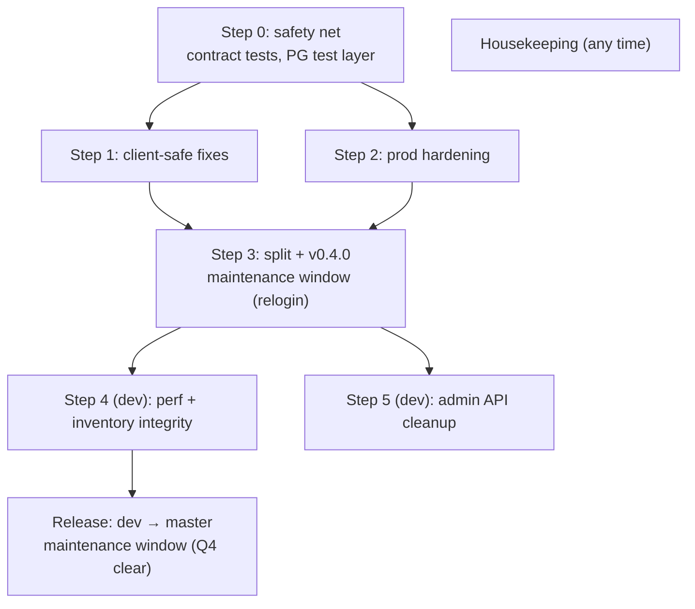

# Implementation plan and task guideline

Status: **planned, not started.** Work begins only when the maintainer says so, either one step
at a time or one task at a time.

This plan turns the decisions in these files into tasks:

- [BRANCH_SPLIT_REVIEW.md](BRANCH_SPLIT_REVIEW.md) (the "base review")
- [BRANCH_SPLIT_DELTA.md](BRANCH_SPLIT_DELTA.md) (decision rounds D1–D5; the latest round wins)
- [STOCK_MODEL_DISCUSSION.md](STOCK_MODEL_DISCUSSION.md)

Precedence when they disagree: **delta > this plan > base review**. If this plan conflicts with
a delta decision, the delta is right and this plan must be fixed.

---

## 1. Working agreement (for the implementing agent)

### 1.1 Before any task

1. Confirm that the maintainer has started **this** step or task. Do not start the next task on
   your own.
2. Re-read the task here, the delta rounds it references, and `KNOWN_LIMITATIONS.md`, which is
   mandatory reading under its own rules.
3. Use the code-review-graph tools first (`CLAUDE.md`): callers, `tests_for`, impact radius.
   Then **read the actual source and its tests**. The graph may be stale, and the source wins.
4. Never read, grep, or print active `.env` files. Use `.env.example` only (Known Limitation #6).

### 1.2 Hard guardrails

| Rule | Why |
|---|---|
| **Contract v1 is frozen.** Any change to an operation or WS frame used by the operator client must keep base review §2 true. Run `tests/test_client_contract_v1.py` (T0.2) on every task. If it fails, stop and fix, or ask. Never update the snapshot to make it pass unless the change is purely additive. | The client is updated manually (Known Limitation #8). |
| **Every WS frame has `data` as a list of objects**, for both client and admin sockets. | Both apps parse `data` before checking `type`. |
| Success codes for client-used operations stay **200**. | The client checks `== 200`. |
| No new runtime dependency without asking. | It affects the prod image and its supply chain. |
| No commit, push, branch creation, tag, merge, or GitHub setting change without the maintainer's explicit go-ahead, every time. | Outward-facing actions. |
| Never touch production systems or data. Production steps are written as runbooks for the maintainer. | Uptime is not critical, but the data is. |
| Migrations are hand-reviewed, schema-qualified (`schema="warehouse"` etc.), and include a working `downgrade()`. Test them from an **empty** PostgreSQL database and from the previous release. | TESTING.md release gate; migration `d862d86e8707` shows why. |
| Bypass, mode, and hardening code follows the documented-block pattern: a comment block in the code plus an OPERATIONS section. Dormant hardening uses `HARDENING(<name>)` tags. | D4.2. |
| If behaviour is ambiguous and not settled by the delta, stop and ask. Do not pick silently. | |

### 1.3 Definition of done (per task)

- [ ] Code change is limited to the task's scope (no drive-by refactors; note them as follow-ups instead).
- [ ] A regression test is added for each bug fixed (TESTING.md). Tests are named after observable behaviour.
- [ ] Unit suite, Ruff, contract test, and (where the task says so) the PostgreSQL integration suite all pass.
- [ ] Docs are updated where behaviour, configuration, or endpoints change: `docs/API.md`, `docs/OPERATIONS.md`, `KNOWN_LIMITATIONS.md` (mandatory rule #2), `docs/ARCHITECTURE.md`.
- [ ] The task's row in §7 (progress tracker) is updated with its status and any follow-ups.
- [ ] A short report to the maintainer: what changed, test output, anything skipped and why.

### 1.4 Verification commands

```bash
# backend — fast loop (host)
cd backend && uv run ruff check src tests && uv run ruff format --check src tests
cd backend && uv run python -m pytest                     # unit + contract (SQLite/fakes)
cd backend && uv run python -m pytest -m integration      # PostgreSQL layer (after T0.3)

# backend — canonical (Docker)
cd backend && docker compose -f compose.yaml -f compose.test.yaml run --build --rm tests
docker compose -f backend/compose.yaml config --quiet
docker compose -f backend/compose.yaml -f backend/compose.prod.yaml config --quiet   # after T2.2

# frontends (only for tasks touching them)
cd frontend/client && flutter analyze && flutter test
cd frontend/admin  && flutter analyze && flutter test
```

### 1.5 Branching and commits (once the maintainer approves each one)

- Steps 0–2 happen before `dev` exists. Use short-lived branches off `master`, named
  `<type>/<task-id>-<slug>`, for example `fix/T1.1-active-orders-now`, and merge them into
  `master` as the maintainer directs.
- After step 3, feature branches come off `dev`, and releases go `dev → master` through a
  release PR plus a tag (base review §4.1; `client/vN` is kept for reference only).
- Use **one task per commit** (or a few commits), with messages that reference the task ID
  and finding IDs (`T1.4 / F-H4`).
- The maintainer's own uncommitted tooling changes (`.gitignore`, client
  `analysis_options.yaml`, Gradle files, `pubspec.lock`) are **not** bundled into task commits
  unless they ask.

---

## 2. Decisions made while planning (veto before the step starts)

These came up while writing the plan. None is settled by the delta. Each one has a default
that applies unless you say otherwise.

| # | Topic | Default in this plan | Alternative |
|---|---|---|---|
| P-1 | Behaviour when `APP_ENV` is unset | **Fail closed**: unset means production rules. `compose.yaml`, tests, and `.env.example` set `APP_ENV=development` explicitly. | Unset means development (convenient, but a forgotten variable in prod is unsafe). |
| P-2 | Can a `done` order be claimed? | **No**: 409 "Order already completed". The client shows its existing 409 alert. | Keep allowing it (today's behaviour). |
| P-3 | WS error frame shape | `{"type": "error", "data": [{"detail": "…"}]}`, a list as the frame rule requires. Both apps ignore `error`. | Keep string data (breaks the frame rule; today it is reachable only through admin `get_users` misuse and unknown commands). |
| P-4 | Login throttling | Redis counter per username: 10 failures in 15 min → **429** for 15 min. The client shows "Login failed (Status 429)". A dummy Argon2 verify runs when the user is missing. | Per IP as well. The client connects directly, so IPs are real, but shared NAT on the warehouse network could lock everyone out. |
| P-5 | Request length limits (client-used fields) | `content` ≤ 512, `tags` ≤ 16 items × 64, `sku` ≤ 200, `location`/`move_to` ≤ 64, close list ≤ 5,000. Anything over → 422, which the client shows as "Failed". | Different numbers. Check real label and barcode lengths first. |
| P-6 | CI | GitHub Actions workflow in the repo (`.github/workflows/`), run on PRs to `dev` and `master`. | Local release-gate script only (no Actions minutes). |
| P-7 | Placement of findings the approved sequencing didn't list | See §6, rows marked "placed in planning". | Move or drop any row. |
| P-8 | `alembic` dependency group | Move `alembic` from the dev group to main dependencies (the prod image runs it), drop `fastapi[standard]` in favour of `fastapi` + `uvicorn[standard]`, and export with `--no-dev`. | Leave packaging as is. |

---

## 3. Dependency overview



Hard ordering constraints:

- T0.2 and T0.3 come before anything else, because every later task runs them.
- T2.5 (registration flag) ships **together with** T2.6 (admin user creation and reset). This is
  required by D2.2.
- T1.2 (key retention) is deployed **before** or **in** the step 3 window, where the A-7 relogin
  happens.
- T4.3 (stock engine) depends on T0.3 (row locks need PostgreSQL) and on T4.2 (unit of work).
- T4.4 (Q4 clear) runs **only** in the production window that ships T4.3.

---

## 4. Tasks

Each task lists: **Goal** · **Refs** · **Change** · **Tests** · **Docs** · **Accept**.
"Client-safe ✔" means no contract v1 change; this is verified by the contract test.

### Step 0: safety net (`master`)

**T0.1 Commit planning docs** *(needs go-ahead)*
- Goal: get the review, delta, stock discussion, this plan, Known Limitation #8, and the
  PROJECT index into version control.
- Change: commit only those docs files. Add `backend/.coverage` to `.gitignore` (the file is
  untracked and generated).
- Accept: `git status` shows only the maintainer's own pending tooling changes.

**T0.2 Client contract v1 tests**
- Goal: make §2 of the base review executable.
- Refs: base review §2; delta D1.3 (scope is the operator client only).
- Change: add `tests/contracts/client_v1.json`, a snapshot of the OpenAPI fragments for every
  client-used operation (path, method, request schema, 200 response schema).
- Tests: `tests/test_client_contract_v1.py`, which checks:
  - every client operation exists, with the method and `200` success code declared
  - request required fields and types are unchanged
  - response fields the client parses as required exist, are non-nullable, and keep their
    types (`id: int`, datetimes as strings, `quantity: int`, lists stay lists)
  - an **additive-only diff** against the snapshot: new optional fields pass; removed fields,
    renames, or changes to required-ness or type fail
  - WS frame-shape test: for each `WSMessageType`, `ConnectionManager._get_data` for a
    client-scope user returns `list[dict]`, and the WS router sends only list-shaped `data`
    (this fails until T1.9 lands, so mark it `xfail(strict=True)` and point at T1.9)
  - WS handshake: a missing or invalid ticket is rejected with HTTP 403 (verifies F-M4's
    constraint)
- Accept: the suite passes on current `master` (apart from the documented `xfail`).

**T0.3 PostgreSQL integration test layer**
- Goal: real-database tests for migrations, row locks, `RETURNING`, and `coalesce` indexes.
- Change:
  - Add a `postgres` service to `compose.test.yaml` (tmpfs volume, test credentials, not
    secrets).
  - Add a `tests/integration/` package marked `integration`.
  - Add a fixture that runs `alembic upgrade head` on an empty database and yields sessions;
    each test gets its own transaction or truncation.
- Tests: migration smoke (empty → head → base → head), and that schemas and tables exist.
- Docs: TESTING.md, covering the integration layer and how to run it.
- Accept: `pytest -m integration` passes in Docker. The unit suite does not need PostgreSQL.

**T0.4 Baseline record**
- Goal: know the starting state.
- Change: none. Run §1.4, then record pass/fail counts, coverage, and Flutter analyzer output
  in §7.
- Accept: the baseline row is filled in.

### Step 1: client-safe correctness (`master`)

All Step 1 tasks are client-safe.

**T1.1 Active-order filter uses the current time (F-C1)**
- Change: replace the module-level `lection_query` (`queries/orders.py:19-28`) with a function
  that builds the query per call (with `func.now()` or a `datetime.now(UTC)` parameter). Update
  its 3 users and `__init__` exports. Rename it to `active_orders_query()`.
- Tests: an order whose `ship_by` passes after import is excluded. The unit test uses a fixed
  clock; the integration test uses a real `now()`.

**T1.2 Key retention covers refresh tokens (F-C2)**
- Change (`managers/key_manager.py`):
  - Add `KEY_RETENTION_SECONDS`, defaulting to `REFRESH_TTL + ACCESS_TTL + JWT_LEEWAY`.
  - Prune only keys whose **successor** became the signer more than the retention period ago,
    using kid timestamps.
  - The cancel path must **never** prune. It completes a half-written signer pair or leaves
    files as they are.
  - JWKS will now hold 2–3 keys; the clients' JWKS caching handles that.
- Tests (fake clock and temporary key directory):
  - a refresh token signed by the previous key still verifies after rotation completes
  - keys are pruned once the retention period passes
  - cancelling mid-rotation keeps old keys
- Docs: OPERATIONS key section and the base review §4.5 note. The "don't deploy during
  rotation" rule is lifted once this lands.

**T1.3 Escape LIKE in barcode/SKU resolution (F-H3)**
- Change (`queries/warehouse.py`):
  - Exact matches (SKU candidate, supplier barcode, SKU fallback) become
    `func.lower(col) == value.lower()`.
  - `find_warehouse_items` substring search escapes `\ % _` with `escape="\\"`.
- Tests: scanning `%` or `_` resolves to nothing; `A01_001` does not match `A01X001`;
  case-insensitivity is preserved; the existing barcode pipeline tests still pass.

**T1.4 Atomic order claim (F-H4, P-2)**
- Change (`queries/orders.py::acquire_order`): one
  `UPDATE … SET owner_user=:u WHERE order_sn=:sn AND (owner_user IS NULL OR owner_user=:u) AND done=false RETURNING order_sn`.
  When 0 rows come back, a follow-up `SELECT` separates the cases:
  - not found → `False`, which the service maps to 404 (unchanged)
  - owned by another operator → `ValueError`, mapped to 409 (unchanged message)
  - done → `ValueError("Order already completed")`, mapped to 409
- Tests: a concurrent claim on PostgreSQL (two sessions) produces exactly one winner; plus 404
  and 409 cases.

**T1.5 Single-gate refresh rotation (F-H5)**
- Change: add `queries.consume_refresh_token(jti)`, which runs
  `DELETE … WHERE jti=:j RETURNING username, expires_at, revoked_at`. `refresh_tokens` uses it
  as the only gate. Expired or revoked tokens are deleted, and the call returns 401.
- Tests: a second refresh with the same token returns 401; the expired and revoked paths still
  return 401.

**T1.6 Period-close counts (F-M1)**
- Change (`queries/outbound.py:114`): `unknown = |inputs − distinct matched content|`,
  computed from `RETURNING OutboundItem.content`.
- Tests: two operators scanning the same label → `outbound = 2`, `unknown = 0`; the duplicate
  input case still works.

**T1.7 Idempotent WS disconnect (F-M10)**
- Change: `ConnectionManager.disconnect` tolerates sockets that are already removed.
- Tests: a send failure followed by a `WebSocketDisconnect`, for a user with 2 sessions, does
  not raise.

**T1.8 One-use tickets via GETDEL (F-M11)**
- Change: add `RedisManager.getdel`; `consume_ticket` uses it. Update `FakeRedisClient` in
  tests.
- Tests: two consumers racing on one ticket → only one succeeds.

**T1.9 List-shaped WS error frames (P-3)**
- Change (`routers/websocket.py`): send `[{"detail": …}]` for the forbidden and
  unknown-command errors. Remove the T0.2 `xfail`.
- Docs: the API.md WS section.

### Step 2: production hardening (`master`)

**T2.1 `APP_ENV` profile and fail-fast checks (A-2, P-1, F-M15)**
- Change: add a `src/settings_guard.py`, or extend `config.py`, run from `lifespan` before
  seeding. Values are `APP_ENV ∈ {development, staging, production}`. With production rules,
  startup refuses if any of these hold:
  - the default or empty admin password
  - CORS `*` or any regex/origins, unless explicitly allowed
  - `MOCK_ORDER_BYPASS` on
  - `DATABASE_URL` missing (no SQLite fallback)
  - `REDIS_URL` without credentials
  - API docs enabled without `EXPOSE_API_DOCS=1`
  - `ALLOW_REGISTRATION` on
  - `RECIPIENT_RETENTION_DAYS > 90`

  `STOCK_LOCATION_MODE` is **not** on this list (A-8).
- Tests: each rule refuses startup with a clear error; development passes.
- Docs: OPERATIONS "Environment profiles"; `.env.example` sets `APP_ENV=development`.

**T2.2 Production compose and packaging (F-C4, F-M16, P-8)**
- Change: add `backend/compose.prod.yaml` with:
  - no published ports for `db` and `redis`, on an internal network
  - Redis `requirepass` from a file secret, and `REDIS_URL` carrying it
  - `file:` secrets for `database_url`, `partner_key`, `admin_password`, `redis_password`
  - a Redis healthcheck and `restart: unless-stopped`
  - `APP_ENV=production`

  Also add `.env.production.example`, and apply P-8 to `pyproject.toml` and the
  requirements export.
- Tests: `docker compose … config --quiet` for both files; the image builds; the container
  starts with a production example config against the test stack.
- Docs: OPERATIONS deployment section, and the secrets table "current setup" column.

**T2.3 Production CORS = none (F-M14, D1.2)**
- Change: with production rules, add no CORS middleware unless origins are explicitly
  configured; never add the implicit localhost regex outside development.
- Tests: no `Access-Control-Allow-Origin` header in production; development is unchanged.

**T2.4 API docs switch**
- Change: `docs_url`, `redoc_url`, and `openapi_url` are `None` unless development or
  `EXPOSE_API_DOCS=1`. Contract tests call `app.openapi()` directly, so they are unaffected.

**T2.5 Registration flag (F-C3, A-3)**
- Change: `ALLOW_REGISTRATION` (default on in development, off in production).
  `/auth/register` returns **403** `{"detail": "Registration is disabled"}` when it is off. The
  path and schema are unchanged. Client-safe ✔.
- Ships with T2.6.

**T2.6 Admin user creation and password reset (A-3, A-3a, A-3b, D4.2)**
- Change:
  - `POST /admin/users {username, password}` creates a **client-scope** user and returns 409
    for duplicates.
  - `POST /admin/users/{username}/password {password}` resets the password, deletes all the
    user's refresh tokens, and closes their WS sessions (T2.7).
  - Both broadcast `users_update` to admins.
  - New models `AdminUserCreate` and `AdminPasswordReset` carry the **dormant**
    `HARDENING(password-min-length)` block, exactly as in D4.2, plus a commented-out test.
  - Admin web: a create-user form and a reset-password action in `users_view.dart`, with new
    `AppState` calls.
- Tests: create, duplicate (409), reset revokes refresh tokens, a non-admin gets 403, and the
  username validator is reused.
- Docs: API.md; OPERATIONS "Dormant hardening switches" (lists tags and
  `grep -rn "HARDENING(" backend/`); a KNOWN_LIMITATIONS entry for the dormant rule.

**T2.7 Close sockets on user delete/reset (F-M9)**
- Change: `ConnectionManager.disconnect_user(username, code=1008)` closes and forgets all of a
  user's sockets. It is called from delete and reset. The v1 client sees `onDone`, reconnects,
  fails to get a ticket (401), fails to refresh, and logs out. That is the intended outcome.
- Tests: the sockets are closed and the registry is cleaned up.

**T2.8 Operator order scope on HTTP (A-9, F-M7)**
- Change: `sync_shopee_orders` returns the caller's own orders for client scope and all orders
  for admin scope. Client-safe ✔, because the body is ignored.
- Tests: an operator never receives another operator's or an unclaimed order in the HTTP body.

**T2.9 `STOCK_LOCATION_MODE` (A-8, A-8a)**
- Change: `STOCK_LOCATION_MODE=single|multi`, default `multi`. Accept both legacy flags as
  deprecated aliases with a warning. Logic is unchanged here; the engine refactor is T4.3.
- Docs: OPERATIONS section renamed "Stock location mode"; `.env.example`.

**T2.10 Live-Shopee guard outside production (A-10)**
- Change: when not in production, refuse startup if `SHOPEE_URL` is the live host, unless
  `ALLOW_LIVE_SHOPEE_IN_NONPROD=1` is set.
- Tests: the guard trips, and the override works.

**T2.11 Recipient retention task (A-10b, D4.1)**
- Change: a background task modelled on `remove_outdated_refresh_task`, controlled by
  `RECIPIENT_RETENTION_DAYS=30` with a daily interval. It deletes
  `shopee.order_recipient_address` rows and nulls `shopee.order_info.note` where:
  - `done_at < now − N`, **or**
  - `done = false AND ship_by < now − N`

  Order SNs and tracking numbers are kept. Each run logs counts only, never values.
- Tests: rows past the boundary are purged, rows within it are kept; both clocks are covered;
  the client and admin parsers tolerate a null `recipient_address`.
- Docs: OPERATIONS "Data retention", covering 30 days (DPP maximum 90), backup retention ≤ 90
  (ideally 30), and the rule that recipient data never goes in logs.

**T2.12 Redact Shopee URLs in logs (F-H9)** *(placed in planning)*
- Change: one helper strips the query string from any URL or exception text before logging in
  `shopee_service.py`. Log the path, status, and Shopee `request_id` only.
- Tests: a simulated `ContentTypeError` with a token in the URL produces log output without
  `access_token` or `sign`.

**T2.13 Login throttling (F-M17, P-4)** *(placed in planning)*
- Change: a Redis failure counter and 429 response for `/auth/login` and `/auth/admin`, plus a
  dummy hash verification when the user is missing. If Redis is down, login is allowed and a
  warning is logged (fail open; don't lock everyone out).
- Tests: the threshold, the reset on success, and the Redis-down behaviour.

**T2.14 Request size limits (P-5)** *(placed in planning)*
- Change: `max_length` / `max_items` on `OutboundCreate`, `PickItemEntry*`, `StockCreate`, and
  the `/outbound/close` body.
- Tests: values over the limit → 422; values at the limit pass.
- Contract: adding `maxLength`/`maxItems` to a request schema narrows the contract, so the
  T0.2 diff check flags it. Update the snapshot **deliberately in this task only**, limited to
  the P-5 limits, and note it in the commit. Real client payloads stay well under the limits.

**T2.15 Step 2 docs sweep**
- Update `docs/API.md` (new admin endpoints, the register flag, the WS error shape), OPERATIONS
  (all of the above), KNOWN_LIMITATIONS #3 (the mode name), and the README quick start
  (`APP_ENV`).

### Step 3: the split (`master` → `dev`; maintenance window)

**T3.1 Version unification (A-7)**
- Change:
  - The version lives in `pyproject.toml` only. `API_VERSION` is read from it at startup (with
    `tomllib`), with an environment override allowed only in development.
  - Add `CLIENT_CONTRACT = 1`, a constant that `/meta` (T4.7) will expose.
  - Decouple `JWT_VERSION` from releases: iss/aud default to `api.bakingholic:<APP_ENV>` and
    `auth.bakingholic:<APP_ENV>`.
  - Bump to `0.4.0`.
- Tests: the version comes from one source; iss/aud differ per environment.
- Note: deploying this is a **forced relogin** (planned in T3.6).

**T3.2 Tracked synthetic seed tooling (A-10)**
- Change: add `backend/scripts/seed_dev/`, covering items, BOMs (standard and marketplace),
  stock in both modes, orders in several statuses, split packages, and tracking. It refuses to
  run under production rules. It uses no real data and is shaped from sandbox structure only.
- Docs: TESTING and OPERATIONS. This replaces the git-ignored `temp/seed_mock_order.py` path in
  the docs.
- Note: whether the data is reliable enough is **your assessment** (A-10a).

**T3.3 CI (P-6)**
- Change: `.github/workflows/ci.yml` runs on PRs to `dev` and `master`. Jobs:
  - lint and unit (with contract tests)
  - integration (PostgreSQL and Redis services)
  - migration gate: empty → head, and last `v*` tag → head
  - `flutter analyze` and `flutter test` for both apps
- Note: enabling required checks and branch protection is a GitHub setting, and therefore
  **your task**.

**T3.4 Release runbook (`docs/RELEASE.md`)**
- Content:
  - release PR checklist and tagging
  - the maintenance window procedure: announce; operators finish work; back up the database,
    Redis, and `data/keys`; deploy; migrate; smoke test (login, sync, claim, pick, scan,
    close); tell operators to tap *retry* or log in again
  - rollback by redeploying the previous tag and running `alembic downgrade` to its revision
  - a per-release "contract v1 untouched" sign-off

**T3.5 Create `dev` and tag** *(needs go-ahead; your repository settings)*
- I prepare the commands; you run or approve them. Tag `v0.4.0` on `master`, create `dev` from
  it, and push both.
- You then switch the remote default branch to `dev` and set branch protection.

**T3.6 Production window #1** *(you run it; runbook from T3.4)*
- Deploy `v0.4.0` (T1.x, T2.x, T3.1). Every device logs in again (A-7). Rotate the admin
  password to a file secret.

### Step 4: performance and inventory integrity (`dev`)

**T4.1 Stop blocking the event loop (F-H1)**
- Change:
  - `get_current_user` and `require_admin` become plain `def`, so FastAPI runs them in its
    threadpool.
  - Async routes and services call sync queries via `run_in_threadpool` / `asyncio.to_thread`.
  - Argon2 work (`register`, `unlock`, admin create/reset) moves to a thread.
  - The WS router's user lookup and `ConnectionManager._get_data` run in a thread.
- Tests: an async test asserts that the event loop stays responsive while a slow fake query
  runs.

**T4.2 Unit of work (F-M12)**
- Change: one session per service operation (a context manager passed down, or a
  `UnitOfWork`). Query functions accept a session. WS events are published **after commit**.
  Do this incrementally: picks and stock first, then the rest.
- Tests: on failure, nothing is half-applied (pick plus stock).

**T4.3 Inventory transaction integrity (F-H6, A-4, D1.4.2, D4.3 rules 1–8, F-M8)**
- Migration (expand):
  - `orders.pick_stock_allocations (id, pick_entry_id FK, sku, location, qty, created_at)`
  - nullable structured columns on `warehouse.stocks_log`: `sku, location, delta, before,
    after, reason, actor, ref_type, ref_id`
  - merge duplicate `(sku, location)` rows, then add a unique index on
    `(sku, coalesce(location, ''))`
- Engine:
  - Add a `LocationPolicy` with `MultiLocationPolicy` and `SingleLocationPolicy` (§8 of the
    stock discussion).
  - `update_or_move_stock` and pick deduction are rewritten on top of it.
  - Remove `get_or_merge_stock` and the duplicated mode branches.
- Behaviour:
  - Deduction order: the item's default location first, then other bins by `location`
    ascending.
  - Allocations are written per bin. A `pick_shortfall` log row records any unmet quantity.
  - Split on assign uses FIFO of deducted quantity.
  - Delete restores from allocations, for both unassigned and assigned entries. In `multi`
    mode stock goes back to the original bin (recreated if needed); in `single` mode to the
    current sole location. The actor is the deleting user, including an admin.
  - Unassign leaves stock unchanged.
  - Log reasons: `adjust_set`, `adjust_add`, `transfer_out`, `transfer_in`, `pick`,
    `pick_shortfall`, `pick_restore`, `mode_merge`.
  - Lock order: the entry, then its allocations, then stock rows `ORDER BY sku, location FOR
    UPDATE`.
- F-M8: `POST /pick-items` with an `order_sn` requires an existing order owned by the caller
  that is not done; otherwise 404/409 (the client treats non-200 as failure). Assign requires
  an active order.
- Maintenance command: `scripts/stock_merge_single.py` (A-8b) merges all multi-row SKUs when
  switching to `single`.
- Tests: parametrized **per mode**. On PostgreSQL: concurrent picks on one SKU (no lost
  update), restore after shortfall (no phantom stock), split then delete restores the right
  amounts, restore to a recreated bin, and the merge command.
- Docs:
  - OPERATIONS "Inventory": the D1.4.2 note text from the stock discussion §7, mode switching,
    and the merge command
  - KNOWN_LIMITATIONS #5 updated
  - ARCHITECTURE "Inventory"

**T4.4 Q4 cutover command (D5)**
- Change: `scripts/clear_open_pick_entries.py`. It deletes all pick entries **without
  restoring** stock, prints a count, and logs one `StocksLog` row with reason
  `cutover_clear`. It requires a `--confirm` flag.
- Runbook: run it in the production window that ships T4.3, after operators have finished
  their open picks.

**T4.5 Order response and fan-out efficiency (F-H2, F-M13, F-M5)**
- Change:
  - Batch-load items and BOMs for all orders in one pass, with a per-request BOM expansion
    cache.
  - Build each audience payload once.
  - Compute scope-independent payloads (`stocks_update`) once per broadcast.
  - Pass the scope in, so there is no per-recipient user lookup.
  - Fill `split_up`, `shipping_carrier`, and `done_at`.
- Tests: the query count for N orders is bounded (SQLAlchemy event counter); the payload is
  unchanged apart from the newly filled fields.

**T4.6 Datetime offsets (F-M6)**
- Change: serialize all API and WS datetimes as UTC with a `Z`. Use a shared Pydantic type, or
  treat naive values as UTC. A `timestamptz` migration is optional and goes in the backlog.
- Tests: the contract test checks that the format parses with Dart-compatible ISO-8601 (`Z`
  suffix), and the admin app displays local time.

**T4.7 `GET /meta` (A-5, A-5a)**
- Change: public, returning only non-sensitive fields: `{api_version, client_contract: {min:1,
  max:1}, app_env, stock_location_mode, features}`. No secrets, no hostnames.
- Docs: API.md.

**T4.8 Sync completeness and status codes (F-M2, F-M3, F-M4)**
- Change:
  - Also refresh details for locally active orders outside the window.
  - Update `ship_by`, items, and recipient for existing orders. Do not recreate recipient rows
    that retention has purged (A-10b).
  - Failed chunks prevent `mark_synced`.
  - Upstream failure → 502; circuit open → 503. Client-safe: the client only checks for 200.
- Tests: a cancelled old order leaves the active list; a partial failure doesn't mark the sync
  done.

### Step 5: admin API cleanup (`dev`)

- **T5.1** `cfg_token` moves from the query string to an `X-Config-Token` header (F-M18). Admin
  web is updated.
- **T5.2** Pagination for `/admin/history/*` (limit/offset or cursor), with admin web updates.
- **T5.3** Dead code removal: `barcode_service`, the `resolve_standard_bom(_internal)` chain,
  `pick_item_service.merge_or_create_pie`, `get_all_warehouse_items`, `get_all_stocks_data`,
  `ShopeeOrderCreate`, and `PickItemEntryLog`. Dropping that table needs a migration; ask
  first.
- **T5.4** Small fixes:
  - nginx `pick_items` → `pick-items`
  - `/admin/export/scans` summary text
  - `/admin/bom/tree` `qty ≥ 1` validation
  - BOM headers N+1
  - response models for the BOM routes

### Housekeeping (any time; D2.1)

- **TH.1**
  - Delete `frontend/client/web/` and `frontend/admin/windows/`.
  - Update README lines 19–20, ARCHITECTURE "Frontends", and Known Limitation #7 (admin only;
    the client web build is dropped).
  - Update TESTING.md Flutter commands if needed.
  - Check `flutter analyze` for both apps.
- **TH.2** Doc drift:
  - package chunk size (docs say 10, code says 50)
  - Known Limitation #6's references to `AGENTS.md` / `GEMINI.md`
  - document or retire the `STOCK_SINGLE_LOCATION_BYPASS` alias (covered by T2.9)

---

## 5. Backlog (not scheduled)

- **Client v2 (next client major).**
  - Unlimited reconnect backoff (F-H8).
  - URL-encode queries.
  - Parse WS frames by `type` first.
  - Remove the Register button.
  - Use `/meta` (versions, location mode UX).
  - Typed API client generated from OpenAPI, and `AppState` split per feature.
  - Compare resolved SKUs in the over-quantity warning.
  - Clear orders and picks on logout.
  - Ship side by side with v1 through `/v2` routes only where operations change (A-5).
- Move Shopee sync off the request path to a scheduled worker; consider Shopee push
  notifications.
- Multi-worker readiness: Redis pub/sub fan-out and a distributed sync lock.
- Admin shortfall/reconciliation report (Q5).
- `timestamptz` migration.
- Promote the structured `StocksLog` to the stock source of truth (only if needed).

---

## 6. Finding coverage

Every finding in the base review maps to a task or to an explicit deferral.

| Finding | Task | | Finding | Task |
|---|---|---|---|---|
| F-C1 | T1.1 | | F-M5 | T4.5 |
| F-C2 | T1.2 | | F-M6 | T4.6 |
| F-C3 | T2.5 + T2.6 | | F-M7 | T2.8 |
| F-C4 | T2.2 | | F-M8 | T4.3 *(placed in planning)* |
| F-H1 | T4.1 | | F-M9 | T2.7 |
| F-H2 | T4.5 | | F-M10 | T1.7 |
| F-H3 | T1.3 | | F-M11 | T1.8 |
| F-H4 | T1.4 | | F-M12 | T4.2 |
| F-H5 | T1.5 | | F-M13 | T4.5 |
| F-H6 | T4.3 | | F-M14 | T2.3 |
| F-H7 | closed (D1.2) | | F-M15 | T2.1 + T2.4 |
| F-H8 | backlog: client v2 (D1.2) | | F-M16 | T2.2 |
| F-H9 | T2.12 *(placed in planning)* | | F-M17 | T2.13 *(placed in planning)* |
| F-M1 | T1.6 | | F-M18 | T5.1 (`ws` ticket: frozen, accepted) |
| F-M2, F-M3 | T4.8 | | Low items | T3.1 (versions), T2.9 (alias), T2.2 (deps), T5.3–T5.4, TH.1–TH.2; Dockerfile migrate-on-start accepted (D1.2) |
| F-M4 | T4.8 + T0.2 (WS 403 check) | | WS error string frames | T1.9 *(placed in planning)* |

---

## 7. Progress tracker

Status values: `todo` · `in progress` · `done` · `blocked` · `skipped`. Update the row in the
same change as the task.

| Task | Status | Notes |
|---|---|---|
| T0.1 | todo | needs go-ahead to commit |
| T0.2 | todo | |
| T0.3 | todo | |
| T0.4 | todo | baseline: — |
| T1.1–T1.9 | todo | |
| T2.1–T2.15 | todo | veto window for P-1…P-5, P-8 |
| T3.1–T3.4 | todo | P-6 |
| T3.5–T3.6 | todo | maintainer-run |
| T4.1–T4.8 | todo | T4.4 runs only in the production window |
| T5.1–T5.4 | todo | |
| TH.1–TH.2 | todo | |
