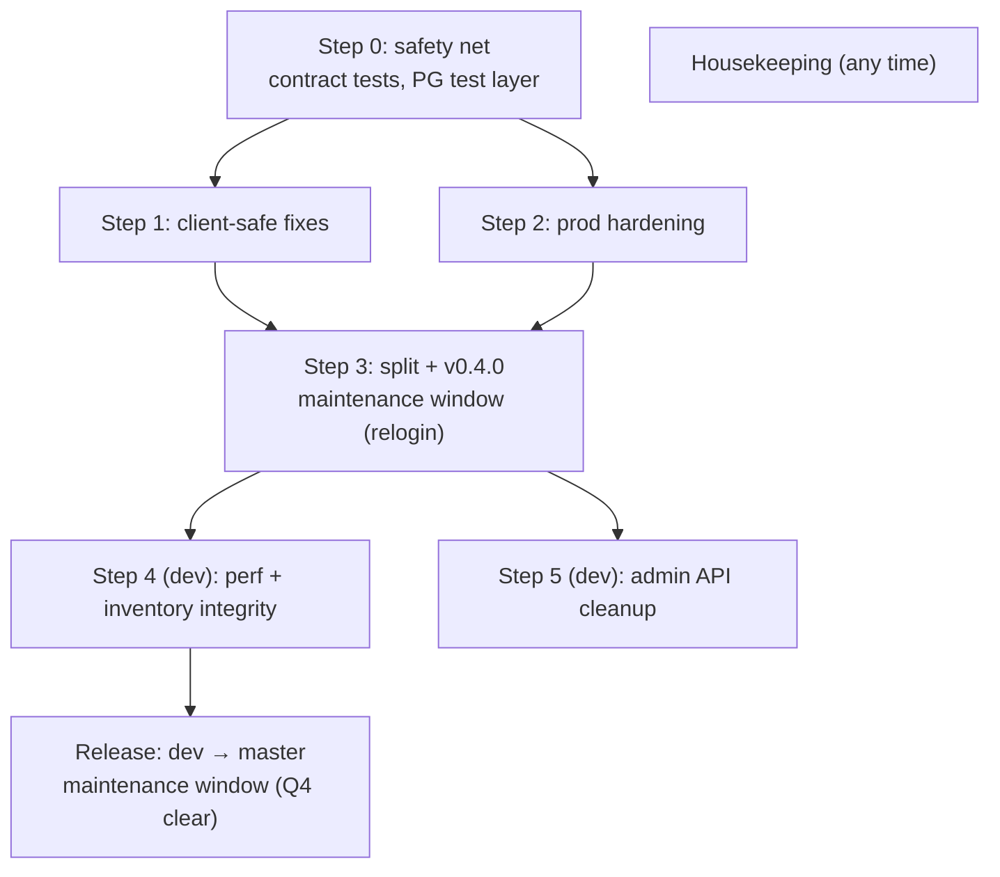
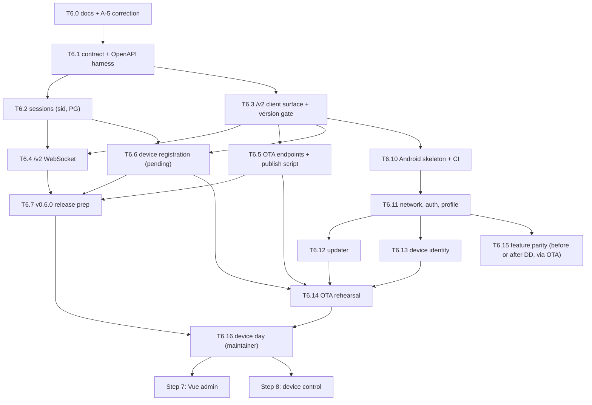

# Implementation plan and task guideline

Status: **steps 0–5 and TF.* done** (v0.4.0 and v0.5.0 released). **Steps 6–8 (v2) are planned,
not started** (§7, as of 2026-11-22). Work begins only when the maintainer says so, either one step at a time or one
task at a time.

This plan turns the decisions in these files into tasks:

- [archive/BRANCH_SPLIT_REVIEW.md](archive/BRANCH_SPLIT_REVIEW.md) (the "base review")
- [archive/BRANCH_SPLIT_DELTA.md](archive/BRANCH_SPLIT_DELTA.md) (decision rounds D1–D5; the latest round wins)
- [archive/STOCK_MODEL_DISCUSSION.md](archive/STOCK_MODEL_DISCUSSION.md)

Steps 6–8 come from [V2_SPEC.md](V2_SPEC.md), [V2_DELTA.md](V2_DELTA.md) (rounds D1–D4) and
[V2_SERVER_ADDRESS.md](V2_SERVER_ADDRESS.md). Precedence there: **V2_DELTA > this plan >
V2_SPEC**.

The branch-split files were archived on 2026-11-21 (see [archive/README.md](archive/README.md)); current
behaviour is described in [SYSTEM_REFERENCE.md](SYSTEM_REFERENCE.md).

Precedence when they disagree: **delta > this plan > base review**. If this plan conflicts with
a delta decision, the delta is right and this plan must be fixed.

---

## 1. Working agreement (for the implementing agent)

### 1.1 Before any task

1. Confirm that the maintainer has started **this** step or task. Do not start the next task on
   your own.
2. Re-read the task here, the delta rounds it references, and `KNOWN_LIMITATIONS.md`, which is
   mandatory reading under its own rules.
3. Use the code-review-graph tools first (`CLAUDE.md`): callers, `tests_for`, impact radius.
   Then **read the actual source and its tests**. The graph may be stale, and the source wins.
4. Never read, grep, or print active `.env` files. Use `.env.example` only (Known Limitation #6).

### 1.2 Hard guardrails

| Rule | Why |
|---|---|
| **Contract v1 is frozen.** Any change to an operation or WS frame used by the operator client must keep base review §2 true. Run `tests/test_client_contract_v1.py` (T0.2) on every task. If it fails, stop and fix, or ask. Never update the snapshot to make it pass unless the change is purely additive. | The client is updated manually (Known Limitation #8). |
| **Every WS frame has `data` as a list of objects**, for both client and admin sockets. | Both apps parse `data` before checking `type`. |
| Success codes for client-used operations stay **200**. | The client checks `== 200`. |
| No new runtime dependency without asking. | It affects the prod image and its supply chain. |
| No commit, push, branch creation, tag, merge, or GitHub setting change without the maintainer's explicit go-ahead, every time. | Outward-facing actions. |
| Never touch production systems or data. Production steps are written as runbooks for the maintainer. | Uptime is not critical, but the data is. |
| Migrations are hand-reviewed, schema-qualified (`schema="warehouse"` etc.), and include a working `downgrade()`. Test them from an **empty** PostgreSQL database and from the previous release. | TESTING.md release gate; migration `d862d86e8707` shows why. |
| Bypass, mode, and hardening code follows the documented-block pattern: a comment block in the code plus an OPERATIONS section. Dormant hardening uses `HARDENING(<name>)` tags. | D4.2. |
| If behaviour is ambiguous and not settled by the delta, stop and ask. Do not pick silently. | |

### 1.3 Definition of done (per task)

- [ ] Code change is limited to the task's scope (no drive-by refactors; note them as follow-ups instead).
- [ ] A regression test is added for each bug fixed (TESTING.md). Tests are named after observable behaviour.
- [ ] Unit suite, Ruff, contract test, and (where the task says so) the PostgreSQL integration suite all pass.
- [ ] Docs are updated where behaviour, configuration, or endpoints change: `docs/API.md`, `docs/OPERATIONS.md`, `KNOWN_LIMITATIONS.md` (mandatory rule #2), `docs/ARCHITECTURE.md`.
- [ ] The task's row in §7 (progress tracker) is updated with its status and any follow-ups.
- [ ] A short report to the maintainer: what changed, test output, anything skipped and why.

### 1.4 Verification commands

```bash
# backend — fast loop (host)
cd backend && uv run ruff check src tests && uv run ruff format --check src tests
cd backend && uv run python -m pytest                     # unit + contract (SQLite/fakes)
cd backend && uv run python -m pytest -m integration      # PostgreSQL layer (after T0.3)

# backend — canonical (Docker)
cd backend && docker compose -f compose.yaml -f compose.test.yaml run --build --rm tests
docker compose -f backend/compose.yaml config --quiet
docker compose -f backend/compose.yaml -f backend/compose.prod.yaml config --quiet   # after T2.2

# frontends (only for tasks touching them)
cd frontend/client && flutter analyze && flutter test
cd frontend/admin  && flutter analyze && flutter test
```

### 1.5 Branching and commits (once the maintainer approves each one)

- Steps 0–2 happen before `dev` exists. Use short-lived branches off `master`, named
  `<type>/<task-id>-<slug>`, for example `fix/T1.1-active-orders-now`, and merge them into
  `master` as the maintainer directs.
- After step 3, feature branches come off `dev`, and releases go `dev → master` through a
  release PR plus a tag (base review §4.1; `client/vN` is kept for reference only).
- Use **one task per commit** (or a few commits), with messages that reference the task ID
  and finding IDs (`T1.4 / F-H4`).
- The maintainer's own uncommitted tooling changes (`.gitignore`, client
  `analysis_options.yaml`, Gradle files, `pubspec.lock`) are **not** bundled into task commits
  unless they ask.

---

## 2. Decisions made while planning (veto before the step starts)

These came up while writing the plan. None is settled by the delta. Each one has a default
that applies unless you say otherwise.

| # | Topic | Default in this plan | Alternative |
|---|---|---|---|
| P-1 | Behaviour when `APP_ENV` is unset | **Fail closed**: unset means production rules. `compose.yaml`, tests, and `.env.example` set `APP_ENV=development` explicitly. | Unset means development (convenient, but a forgotten variable in prod is unsafe). |
| P-2 | Can a `done` order be claimed? | **No**: 409 "Order already completed". The client shows its existing 409 alert. | Keep allowing it (today's behaviour). |
| P-3 | WS error frame shape | `{"type": "error", "data": [{"detail": "…"}]}`, a list as the frame rule requires. Both apps ignore `error`. | Keep string data (breaks the frame rule; today it is reachable only through admin `get_users` misuse and unknown commands). |
| P-4 | Login throttling | Redis counter per username: 10 failures in 15 min → **429** for 15 min. The client shows "Login failed (Status 429)". A dummy Argon2 verify runs when the user is missing. | Per IP as well. The client connects directly, so IPs are real, but shared NAT on the warehouse network could lock everyone out. |
| P-5 | Request length limits (client-used fields) | `content` ≤ 512, `tags` ≤ 16 items × 64, `sku` ≤ 200, `location`/`move_to` ≤ 64, close list ≤ 5,000. Anything over → 422, which the client shows as "Failed". | Different numbers. Check real label and barcode lengths first. |
| P-6 | CI | GitHub Actions workflow in the repo (`.github/workflows/`), run on PRs to `dev` and `master`. | Local release-gate script only (no Actions minutes). |
| P-7 | Placement of findings the approved sequencing didn't list | See §6, rows marked "placed in planning". | Move or drop any row. |
| P-8 | `alembic` dependency group | Move `alembic` from the dev group to main dependencies (the prod image runs it), drop `fastapi[standard]` in favour of `fastapi` + `uvicorn[standard]`, and export with `--no-dev`. | Leave packaging as is. |
| P-9 | v2 WS frame and handshake errors (T6.4) | `{type, data, ts}` with `data` the same list of objects as v1. Handshake errors: accept, then close **4401** (ticket or session) / **4426** (client too old). | Other envelope or codes; delta events instead of snapshots (later). |
| P-10 | `/v2` version gate (T6.3) | `X-Client-Version` required (missing → 400); below `min_supported_version_code` → 426. `/v2/meta`, `/v2/client/*` and `/v2/device/register` are exempt, so an old client can always find its update. | A missing header treated as version 0. |
| P-11 | `/v2` surface (T6.3) | Exactly v1's client operations, **minus** register and JWKS, plus `/v2/meta`, OTA and device endpoints. New v2 operations are added deliberately, with the snapshot. | Also mirror `GET /pick-items` or list endpoints now. |
| P-12 | Device registration proof (T6.6) | ECDSA P-256 signature over the caller's `sid`, made with the Keystore key, verified with `cryptography`. `cryptography` is already installed (via `pyjwt[crypto]`); it becomes a **declared** dependency, with no new package. | No proof at the `pending` stage. |
| P-13 | Hidden settings unlock (T6.11) | 5 s long-press on the version label, then a PIN from local build config (not committed). | The enrollment QR only (step 8); an admin-password check online. |
| P-14 | Kotlin API models (T6.10) | `openapi-generator` Gradle plugin, **build-time only**, models only (kotlinx.serialization), from `backend/openapi/v2.json`. | Hand-written models plus a test against the JSON file. |
| P-15 | APK storage and rollback (T6.5) | `data/releases/client/` mounted like `data/keys`; old APKs kept; a rollback is a new, higher `versionCode` built from old code. | Delete old APKs on publish. |
| P-16 | `last_seen_at` writes (T6.2, T6.6) | At most once per 60 s per session/device. | Every request. |
| P-17 | Vue admin timing | Step 7, after the device day; not a v0.6.0 gate. | Start T7.1 in parallel with T6.10. |
| P-18 | Expired sessions | Removed by the existing refresh-cleanup task. | A separate task. |
| P-19 | Admin "log out everywhere" (T6.2) | `POST /admin/users/{username}/logout`, client accounts only (like reset and delete). | Also for the admin account itself. |
| P-20 | Vue admin token storage (T7.2) | Access token in memory, refresh token in `sessionStorage`: closing the tab logs out, with less XSS exposure. | `localStorage` (survives browser restarts). |
| P-21 | Existing refresh tokens at T6.2 | Deleted by the migration, so everyone logs in once (Q24). | Backfill a session per refresh row (no relogin, more code). |

---

## 3. Dependency overview



Hard ordering constraints:

- T0.2 and T0.3 come before anything else, because every later task runs them.
- T2.5 (registration flag) ships **together with** T2.6 (admin user creation and reset). This is
  required by D2.2.
- T1.2 (key retention) is deployed **before** or **in** the step 3 window, where the A-7 relogin
  happens.
- T4.3 (stock engine) depends on T0.3 (row locks need PostgreSQL) and on T4.2 (unit of work).
- T4.4 (Q4 clear) runs **only** in the production window that ships T4.3.

---

## 4. Tasks

Each task lists: **Goal** · **Refs** · **Change** · **Tests** · **Docs** · **Accept**.
"Client-safe ✔" means no contract v1 change; this is verified by the contract test.

### Step 0: safety net (`master`)

**T0.1 Commit planning docs** *(needs go-ahead)*
- Goal: get the review, delta, stock discussion, this plan, Known Limitation #8, and the
  PROJECT index into version control.
- Change: commit only those docs files. Add `backend/.coverage` to `.gitignore` (the file is
  untracked and generated).
- Accept: `git status` shows only the maintainer's own pending tooling changes.

**T0.2 Client contract v1 tests**
- Goal: make §2 of the base review executable.
- Refs: base review §2; delta D1.3 (scope is the operator client only).
- Change: add `tests/contracts/client_v1.json`, a snapshot of the OpenAPI fragments for every
  client-used operation (path, method, request schema, 200 response schema).
- Tests: `tests/test_client_contract_v1.py`, which checks:
  - every client operation exists, with the method and `200` success code declared
  - request required fields and types are unchanged
  - response fields the client parses as required exist, are non-nullable, and keep their
    types (`id: int`, datetimes as strings, `quantity: int`, lists stay lists)
  - an **additive-only diff** against the snapshot: new optional fields pass; removed fields,
    renames, or changes to required-ness or type fail
  - WS frame-shape test: for each `WSMessageType`, `ConnectionManager._get_data` for a
    client-scope user returns `list[dict]`, and the WS router sends only list-shaped `data`
    (this fails until T1.9 lands, so mark it `xfail(strict=True)` and point at T1.9)
  - WS handshake: a missing or invalid ticket is rejected with HTTP 403 (verifies F-M4's
    constraint)
- Accept: the suite passes on current `master` (apart from the documented `xfail`).

**T0.3 PostgreSQL integration test layer**
- Goal: real-database tests for migrations, row locks, `RETURNING`, and `coalesce` indexes.
- Change:
  - Add a `postgres` service to `compose.test.yaml` (tmpfs volume, test credentials, not
    secrets).
  - Add a `tests/integration/` package marked `integration`.
  - Add a fixture that runs `alembic upgrade head` on an empty database and yields sessions;
    each test gets its own transaction or truncation.
- Tests: migration smoke (empty → head → base → head), and that schemas and tables exist.
- Docs: TESTING.md, covering the integration layer and how to run it.
- Accept: `pytest -m integration` passes in Docker. The unit suite does not need PostgreSQL.

**T0.4 Baseline record**
- Goal: know the starting state.
- Change: none. Run §1.4, then record pass/fail counts, coverage, and Flutter analyzer output
  in §7.
- Accept: the baseline row is filled in.

### Step 1: client-safe correctness (`master`)

All Step 1 tasks are client-safe.

**T1.1 Active-order filter uses the current time (F-C1)**
- Change: replace the module-level `lection_query` (`queries/orders.py:19-28`) with a function
  that builds the query per call (with `func.now()` or a `datetime.now(UTC)` parameter). Update
  its 3 users and `__init__` exports. Rename it to `active_orders_query()`.
- Tests: an order whose `ship_by` passes after import is excluded. The unit test uses a fixed
  clock; the integration test uses a real `now()`.

**T1.2 Key retention covers refresh tokens (F-C2)**
- Change (`managers/key_manager.py`):
  - Add `KEY_RETENTION_SECONDS`, defaulting to `REFRESH_TTL + ACCESS_TTL + JWT_LEEWAY`.
  - Prune only keys whose **successor** became the signer more than the retention period ago,
    using kid timestamps.
  - The cancel path must **never** prune. It completes a half-written signer pair or leaves
    files as they are.
  - JWKS will now hold 2–3 keys; the clients' JWKS caching handles that.
- Tests (fake clock and temporary key directory):
  - a refresh token signed by the previous key still verifies after rotation completes
  - keys are pruned once the retention period passes
  - cancelling mid-rotation keeps old keys
- Docs: OPERATIONS key section and the base review §4.5 note. The "don't deploy during
  rotation" rule is lifted once this lands.

**T1.3 Escape LIKE in barcode/SKU resolution (F-H3)**
- Change (`queries/warehouse.py`):
  - Exact matches (SKU candidate, supplier barcode, SKU fallback) become
    `func.lower(col) == value.lower()`.
  - `find_warehouse_items` substring search escapes `\ % _` with `escape="\\"`.
- Tests: scanning `%` or `_` resolves to nothing; `A01_001` does not match `A01X001`;
  case-insensitivity is preserved; the existing barcode pipeline tests still pass.

**T1.4 Atomic order claim (F-H4, P-2)**
- Change (`queries/orders.py::acquire_order`): one
  `UPDATE … SET owner_user=:u WHERE order_sn=:sn AND (owner_user IS NULL OR owner_user=:u) AND done=false RETURNING order_sn`.
  When 0 rows come back, a follow-up `SELECT` separates the cases:
  - not found → `False`, which the service maps to 404 (unchanged)
  - owned by another operator → `ValueError`, mapped to 409 (unchanged message)
  - done → `ValueError("Order already completed")`, mapped to 409
- Tests: a concurrent claim on PostgreSQL (two sessions) produces exactly one winner; plus 404
  and 409 cases.

**T1.5 Single-gate refresh rotation (F-H5)**
- Change: add `queries.consume_refresh_token(jti)`, which runs
  `DELETE … WHERE jti=:j RETURNING username, expires_at, revoked_at`. `refresh_tokens` uses it
  as the only gate. Expired or revoked tokens are deleted, and the call returns 401.
- Tests: a second refresh with the same token returns 401; the expired and revoked paths still
  return 401.

**T1.6 Period-close counts (F-M1)**
- Change (`queries/outbound.py:114`): `unknown = |inputs − distinct matched content|`,
  computed from `RETURNING OutboundItem.content`.
- Tests: two operators scanning the same label → `outbound = 2`, `unknown = 0`; the duplicate
  input case still works.

**T1.7 Idempotent WS disconnect (F-M10)**
- Change: `ConnectionManager.disconnect` tolerates sockets that are already removed.
- Tests: a send failure followed by a `WebSocketDisconnect`, for a user with 2 sessions, does
  not raise.

**T1.8 One-use tickets via GETDEL (F-M11)**
- Change: add `RedisManager.getdel`; `consume_ticket` uses it. Update `FakeRedisClient` in
  tests.
- Tests: two consumers racing on one ticket → only one succeeds.

**T1.9 List-shaped WS error frames (P-3)**
- Change (`routers/websocket.py`): send `[{"detail": …}]` for the forbidden and
  unknown-command errors. Remove the T0.2 `xfail`.
- Docs: the API.md WS section.

### Step 2: production hardening (`master`)

**T2.1 `APP_ENV` profile and fail-fast checks (A-2, P-1, F-M15)**
- Change: add a `src/settings_guard.py`, or extend `config.py`, run from `lifespan` before
  seeding. Values are `APP_ENV ∈ {development, staging, production}`. With production rules,
  startup refuses if any of these hold:
  - the default or empty admin password
  - CORS `*` or any regex/origins, unless explicitly allowed
  - `MOCK_ORDER_BYPASS` on
  - `DATABASE_URL` missing (no SQLite fallback)
  - `REDIS_URL` without credentials
  - API docs enabled without `EXPOSE_API_DOCS=1`
  - `ALLOW_REGISTRATION` on
  - `RECIPIENT_RETENTION_DAYS > 90`

  `STOCK_LOCATION_MODE` is **not** on this list (A-8).
- Tests: each rule refuses startup with a clear error; development passes.
- Docs: OPERATIONS "Environment profiles"; `.env.example` sets `APP_ENV=development`.

**T2.2 Production compose and packaging (F-C4, F-M16, P-8)**
- Change: add `backend/compose.prod.yaml` with:
  - no published ports for `db` and `redis`, on an internal network
  - Redis `requirepass` from a file secret, and `REDIS_URL` carrying it
  - `file:` secrets for `database_url`, `partner_key`, `admin_password`, `redis_password`
  - a Redis healthcheck and `restart: unless-stopped`
  - `APP_ENV=production`

  Also add `.env.production.example`, and apply P-8 to `pyproject.toml` and the
  requirements export.
- Tests: `docker compose … config --quiet` for both files; the image builds; the container
  starts with a production example config against the test stack.
- Docs: OPERATIONS deployment section, and the secrets table "current setup" column.

**T2.3 Production CORS = none (F-M14, D1.2)**
- Change: with production rules, add no CORS middleware unless origins are explicitly
  configured; never add the implicit localhost regex outside development.
- Tests: no `Access-Control-Allow-Origin` header in production; development is unchanged.

**T2.4 API docs switch**
- Change: `docs_url`, `redoc_url`, and `openapi_url` are `None` unless development or
  `EXPOSE_API_DOCS=1`. Contract tests call `app.openapi()` directly, so they are unaffected.

**T2.5 Registration flag (F-C3, A-3)**
- Change: `ALLOW_REGISTRATION` (default on in development, off in production).
  `/auth/register` returns **403** `{"detail": "Registration is disabled"}` when it is off. The
  path and schema are unchanged. Client-safe ✔.
- Ships with T2.6.

**T2.6 Admin user creation and password reset (A-3, A-3a, A-3b, D4.2)**
- Change:
  - `POST /admin/users {username, password}` creates a **client-scope** user and returns 409
    for duplicates.
  - `POST /admin/users/{username}/password {password}` resets the password, deletes all the
    user's refresh tokens, and closes their WS sessions (T2.7).
  - Both broadcast `users_update` to admins.
  - New models `AdminUserCreate` and `AdminPasswordReset` carry the **dormant**
    `HARDENING(password-min-length)` block, exactly as in D4.2, plus a commented-out test.
  - Admin web: a create-user form and a reset-password action in `users_view.dart`, with new
    `AppState` calls.
- Tests: create, duplicate (409), reset revokes refresh tokens, a non-admin gets 403, and the
  username validator is reused.
- Docs: API.md; OPERATIONS "Dormant hardening switches" (lists tags and
  `grep -rn "HARDENING(" backend/`); a KNOWN_LIMITATIONS entry for the dormant rule.

**T2.7 Close sockets on user delete/reset (F-M9)**
- Change: `ConnectionManager.disconnect_user(username, code=1008)` closes and forgets all of a
  user's sockets. It is called from delete and reset. The v1 client sees `onDone`, reconnects,
  fails to get a ticket (401), fails to refresh, and logs out. That is the intended outcome.
- Tests: the sockets are closed and the registry is cleaned up.

**T2.8 Operator order scope on HTTP (A-9, F-M7)**
- Change: `sync_shopee_orders` returns the caller's own orders for client scope and all orders
  for admin scope. Client-safe ✔, because the body is ignored.
- Tests: an operator never receives another operator's or an unclaimed order in the HTTP body.

**T2.9 `STOCK_LOCATION_MODE` (A-8, A-8a)**
- Change: `STOCK_LOCATION_MODE=single|multi`, default `multi`. Accept both legacy flags as
  deprecated aliases with a warning. Logic is unchanged here; the engine refactor is T4.3.
- Docs: OPERATIONS section renamed "Stock location mode"; `.env.example`.

**T2.10 Live-Shopee guard outside production (A-10)**
- Change: when not in production, refuse startup if `SHOPEE_URL` is the live host, unless
  `ALLOW_LIVE_SHOPEE_IN_NONPROD=1` is set.
- Tests: the guard trips, and the override works.

**T2.11 Recipient retention task (A-10b, D4.1)**
- Change: a background task modelled on `remove_outdated_refresh_task`, controlled by
  `RECIPIENT_RETENTION_DAYS=30` with a daily interval. It deletes
  `shopee.order_recipient_address` rows and nulls `shopee.order_info.note` where:
  - `done_at < now − N`, **or**
  - `done = false AND ship_by < now − N`

  Order SNs and tracking numbers are kept. Each run logs counts only, never values.
- Tests: rows past the boundary are purged, rows within it are kept; both clocks are covered;
  the client and admin parsers tolerate a null `recipient_address`.
- Docs: OPERATIONS "Data retention", covering 30 days (DPP maximum 90), backup retention ≤ 90
  (ideally 30), and the rule that recipient data never goes in logs.

**T2.12 Redact Shopee URLs in logs (F-H9)** *(placed in planning)*
- Change: one helper strips the query string from any URL or exception text before logging in
  `shopee_service.py`. Log the path, status, and Shopee `request_id` only.
- Tests: a simulated `ContentTypeError` with a token in the URL produces log output without
  `access_token` or `sign`.

**T2.13 Login throttling (F-M17, P-4)** *(placed in planning)*
- Change: a Redis failure counter and 429 response for `/auth/login` and `/auth/admin`, plus a
  dummy hash verification when the user is missing. If Redis is down, login is allowed and a
  warning is logged (fail open; don't lock everyone out).
- Tests: the threshold, the reset on success, and the Redis-down behaviour.

**T2.14 Request size limits (P-5)** *(placed in planning)*
- Change: `max_length` / `max_items` on `OutboundCreate`, `PickItemEntry*`, `StockCreate`, and
  the `/outbound/close` body.
- Tests: values over the limit → 422; values at the limit pass.
- Contract: adding `maxLength`/`maxItems` to a request schema narrows the contract, so the
  T0.2 diff check flags it. Update the snapshot **deliberately in this task only**, limited to
  the P-5 limits, and note it in the commit. Real client payloads stay well under the limits.

**T2.15 Step 2 docs sweep**
- Update `docs/API.md` (new admin endpoints, the register flag, the WS error shape), OPERATIONS
  (all of the above), KNOWN_LIMITATIONS #3 (the mode name), and the README quick start
  (`APP_ENV`).

### Step 3: the split (`master` → `dev`; maintenance window)

**T3.1 Version unification (A-7)**
- Change:
  - The version lives in `pyproject.toml` only. `API_VERSION` is read from it at startup (with
    `tomllib`), with an environment override allowed only in development.
  - Add `CLIENT_CONTRACT = 1`, a constant that `/meta` (T4.7) will expose.
  - Decouple `JWT_VERSION` from releases: iss/aud default to `api.bakingholic:<APP_ENV>` and
    `auth.bakingholic:<APP_ENV>`.
  - Bump to `0.4.0`.
- Tests: the version comes from one source; iss/aud differ per environment.
- Note: deploying this is a **forced relogin** (planned in T3.6).

**T3.2 Tracked synthetic seed tooling (A-10)**
- Change: add `backend/scripts/seed_dev/`, covering items, BOMs (standard and marketplace),
  stock in both modes, orders in several statuses, split packages, and tracking. It refuses to
  run under production rules. It uses no real data and is shaped from sandbox structure only.
- Docs: TESTING and OPERATIONS. This replaces the git-ignored `temp/seed_mock_order.py` path in
  the docs.
- Note: whether the data is reliable enough is **your assessment** (A-10a).

**T3.3 CI (P-6)**
- Change: `.github/workflows/ci.yml` runs on PRs to `dev` and `master`. Jobs:
  - lint and unit (with contract tests)
  - integration (PostgreSQL and Redis services)
  - migration gate: empty → head, and last `v*` tag → head
  - `flutter analyze` and `flutter test` for both apps
- Note: enabling required checks and branch protection is a GitHub setting, and therefore
  **your task**.

**T3.4 Release runbook (`docs/RELEASE.md`)**
- Content:
  - release PR checklist and tagging
  - the maintenance window procedure: announce; operators finish work; back up the database,
    Redis, and `data/keys`; deploy; migrate; smoke test (login, sync, claim, pick, scan,
    close); tell operators to tap *retry* or log in again
  - rollback by redeploying the previous tag and running `alembic downgrade` to its revision
  - a per-release "contract v1 untouched" sign-off

**T3.5 Create `dev` and tag** *(needs go-ahead; your repository settings)*
- I prepare the commands; you run or approve them. Tag `v0.4.0` on `master`, create `dev` from
  it, and push both.
- You then switch the remote default branch to `dev` and set branch protection.

**T3.6 Production window #1** *(you run it; runbook from T3.4)*
- Deploy `v0.4.0` (T1.x, T2.x, T3.1). Every device logs in again (A-7). Rotate the admin
  password to a file secret.

### Step 4: performance and inventory integrity (`dev`)

**T4.1 Stop blocking the event loop (F-H1)**
- Change:
  - `get_current_user` and `require_admin` become plain `def`, so FastAPI runs them in its
    threadpool.
  - Async routes and services call sync queries via `run_in_threadpool` / `asyncio.to_thread`.
  - Argon2 work (`register`, `unlock`, admin create/reset) moves to a thread.
  - The WS router's user lookup and `ConnectionManager._get_data` run in a thread.
- Tests: an async test asserts that the event loop stays responsive while a slow fake query
  runs.

**T4.2 Unit of work (F-M12)**
- Change: one session per service operation (a context manager passed down, or a
  `UnitOfWork`). Query functions accept a session. WS events are published **after commit**.
  Do this incrementally: picks and stock first, then the rest.
- Tests: on failure, nothing is half-applied (pick plus stock).

**T4.3 Inventory transaction integrity (F-H6, A-4, D1.4.2, D4.3 rules 1–8, F-M8)**
- Migration (expand):
  - `orders.pick_stock_allocations (id, pick_entry_id FK, sku, location, qty, created_at)`
  - nullable structured columns on `warehouse.stocks_log`: `sku, location, delta, before,
    after, reason, actor, ref_type, ref_id`
  - merge duplicate `(sku, location)` rows, then add a unique index on
    `(sku, coalesce(location, ''))`
- Engine:
  - Add a `LocationPolicy` with `MultiLocationPolicy` and `SingleLocationPolicy` (§8 of the
    stock discussion).
  - `update_or_move_stock` and pick deduction are rewritten on top of it.
  - Remove `get_or_merge_stock` and the duplicated mode branches.
- Behaviour:
  - Deduction order: the item's default location first, then other bins by `location`
    ascending.
  - Allocations are written per bin. A `pick_shortfall` log row records any unmet quantity.
  - Split on assign uses FIFO of deducted quantity.
  - Delete restores from allocations, for both unassigned and assigned entries. In `multi`
    mode stock goes back to the original bin (recreated if needed); in `single` mode to the
    current sole location. The actor is the deleting user, including an admin.
  - Unassign leaves stock unchanged.
  - Log reasons: `adjust_set`, `adjust_add`, `transfer_out`, `transfer_in`, `pick`,
    `pick_shortfall`, `pick_restore`, `mode_merge`.
  - Lock order: the entry, then its allocations, then stock rows `ORDER BY sku, location FOR
    UPDATE`.
- F-M8: `POST /pick-items` with an `order_sn` requires an existing order owned by the caller
  that is not done; otherwise 404/409 (the client treats non-200 as failure). Assign requires
  an active order.
- Maintenance command: `scripts/stock_merge_single.py` (A-8b) merges all multi-row SKUs when
  switching to `single`.
- Tests: parametrized **per mode**. On PostgreSQL: concurrent picks on one SKU (no lost
  update), restore after shortfall (no phantom stock), split then delete restores the right
  amounts, restore to a recreated bin, and the merge command.
- Docs:
  - OPERATIONS "Inventory": the D1.4.2 note text from the stock discussion §7, mode switching,
    and the merge command
  - KNOWN_LIMITATIONS #5 updated
  - ARCHITECTURE "Inventory"

**T4.4 Q4 cutover command (D5)**
- Change: `scripts/clear_open_pick_entries.py`. It deletes all pick entries **without
  restoring** stock, prints a count, and logs one `StocksLog` row with reason
  `cutover_clear`. It requires a `--confirm` flag.
- Runbook: run it in the production window that ships T4.3, after operators have finished
  their open picks.

**T4.5 Order response and fan-out efficiency (F-H2, F-M13, F-M5)**
- Change:
  - Batch-load items and BOMs for all orders in one pass, with a per-request BOM expansion
    cache.
  - Build each audience payload once.
  - Compute scope-independent payloads (`stocks_update`) once per broadcast.
  - Pass the scope in, so there is no per-recipient user lookup.
  - Fill `split_up`, `shipping_carrier`, and `done_at`.
- Tests: the query count for N orders is bounded (SQLAlchemy event counter); the payload is
  unchanged apart from the newly filled fields.

**T4.6 Datetime offsets (F-M6)**
- Change: serialize all API and WS datetimes as UTC with a `Z`. Use a shared Pydantic type, or
  treat naive values as UTC. A `timestamptz` migration is optional and goes in the backlog.
- Tests: the contract test checks that the format parses with Dart-compatible ISO-8601 (`Z`
  suffix), and the admin app displays local time.

**T4.7 `GET /meta` (A-5, A-5a)**
- Change: public, returning only non-sensitive fields: `{api_version, client_contract: {min:1,
  max:1}, app_env, stock_location_mode, features}`. No secrets, no hostnames.
- Docs: API.md.

**T4.8 Sync completeness and status codes (F-M2, F-M3, F-M4)**
- Change:
  - Also refresh details for locally active orders outside the window.
  - Update `ship_by`, items, and recipient for existing orders. Do not recreate recipient rows
    that retention has purged (A-10b).
  - Failed chunks prevent `mark_synced`.
  - Upstream failure → 502; circuit open → 503. Client-safe: the client only checks for 200.
- Tests: a cancelled old order leaves the active list; a partial failure doesn't mark the sync
  done.

### Step 5: admin API cleanup (`dev`)

- **T5.1** `cfg_token` moves from the query string to an `X-Config-Token` header (F-M18). Admin
  web is updated.
- **T5.2** Pagination for `/admin/history/*` (limit/offset or cursor), with admin web updates.
- **T5.3** Dead code removal: `barcode_service`, the `resolve_standard_bom(_internal)` chain,
  `pick_item_service.merge_or_create_pie`, `get_all_warehouse_items`, `get_all_stocks_data`,
  `ShopeeOrderCreate`, and `PickItemEntryLog`. Dropping that table needs a migration; ask
  first.
- **T5.4** Small fixes:
  - nginx `pick_items` → `pick-items`
  - `/admin/export/scans` summary text
  - `/admin/bom/tree` `qty ≥ 1` validation
  - BOM headers N+1
  - response models for the BOM routes

### Steps 6–8: v2 (V2_SPEC, V2_DELTA D1–D4, V2_SERVER_ADDRESS)

Precedence for these steps: **V2_DELTA > this plan > V2_SPEC**. Step 6 is the device-day
critical path and ships as backend **v0.6.0** plus client app **2.0.0**. Step 7 (Vue admin) and
step 8 (device control) follow over normal releases and OTA. Branches: one feature branch per
task (or a small group) off `dev`, for example `feat/T6.2-sessions`.



Hard ordering constraints:

- T6.1 comes first: every later backend task runs the v1 **and** v2 contract checks.
- T6.2 makes `sid` required. It forces **one operator relogin**, in the v0.6.0 window (D4 Q24).
- The device day (T6.16) needs: v0.6.0 deployed (T6.7), a published first APK (T6.5), and a
  rehearsal passed on the emulator **and** the spare MT67 with the **signed release** APK
  (T6.14).
- Feature parity (T6.15) is not a device-day gate (V2-7). Whatever is missing on the day ships
  later over OTA, and operators use v1 for it meanwhile.

### Step 6: dual-contract backend v0.6.0 and the first v2 client (`dev`)

**T6.0 Commit the v2 planning docs and correct A-5** *(needs go-ahead)*
- Goal: get V2_SPEC, V2_DELTA, V2_SERVER_ADDRESS, this step, the CLAUDE.md planning flow and
  KNOWN_LIMITATIONS #10 into version control.
- Change: docs only.
  - KNOWN_LIMITATIONS #8: the `/v2` rule changes from "for the changed operations only" (A-5)
    to "mirror the operator-client surface" (V2-5 + D1).
  - §5 backlog: the "Client v2" bullet points at Step 6 instead.
- Accept: `git status` clean apart from the maintainer's own files.

**T6.1 Contract and OpenAPI harness for two surfaces (Q14, spec §10.2)**
- Change:
  - `build_contract(app, operations)` takes the operation list (and the WS model map), so v1
    and v2 share one implementation.
  - The `CLIENT_OPERATIONS` constant stays the v1 list; `CLIENT_V2_OPERATIONS` is added
    (initially empty).
  - New `tests/test_client_contract_v2.py` + `tests/contracts/client_v2.json`. Additive-only,
    like v1. Regenerating is allowed but must be deliberate: the test prints the diff.
  - Committed OpenAPI exports `backend/openapi/v2.json` (paths under `/v2`) and
    `backend/openapi/admin.json` (`/admin/*`, `/auth/admin`, and the root paths the admin app
    uses). `tests/test_openapi_exports.py` fails when `app.openapi()` and the files differ;
    `--write` regenerates them.
- Tests: the harness itself. The v1 snapshot is unchanged byte for byte.
- Docs: TESTING.md (two contracts, the export files, how to regenerate).
- Accept: the v1 suite and `client_v1.json` are untouched.

**T6.2 Sessions in PostgreSQL, `sid` required, instant revocation (Q19, Q24, Q10, D3.2, D4.2)**
- Migration (additive):
  - `auth.sessions (id PK = sid, username FK, device_id NULL, created_at, last_seen_at,
    revoked_at NULL, ip_address, agent)`. `device_id` gets its FK in T6.6.
  - `auth.refresh_tokens.session_id` FK → sessions `ON DELETE CASCADE`.
  - Existing refresh rows are deleted in the migration. Everyone logs in once (Q24); the
    downgrade removes the column and the table.
- Tokens:
  - Login creates a session. Access and refresh tokens carry `sid`, added to the `require` list
    in both `jwt.decode` calls.
  - Refresh rotation keeps the `sid`. Logout deletes the session (and its refresh rows by
    cascade).
- `get_current_user`: one query loads the user **and** a live session (`revoked_at IS NULL`).
  Missing → 401, as for a deleted user today. `last_seen_at` is written at most once per 60 s
  per session (P-16). `ip_address`/`agent` are written at login (SYSTEM_REFERENCE §14.3).
- WS:
  - The ticket value becomes `{username, sid}` (JSON in the same Redis key).
  - The handshake checks the session.
  - `ConnectionManager` stores `sid` per socket and gains `disconnect_session(sid, code=1008)`.
- Revocation entry points, each in **one transaction**, then sockets closed:
  - logout;
  - password reset (all of the user's sessions);
  - user delete;
  - new admin endpoint `POST /admin/users/{username}/logout` ("log out everywhere", P-19).
- Expired sessions are removed by the existing refresh-cleanup task (P-18).
- Tests (unit + PostgreSQL):
  - a revoked session gets 401 on the next request, and its refresh token fails too;
  - a token without `sid` → 401;
  - a session's sockets close with 1008, while the same user's other sessions stay;
  - `last_seen_at` throttling;
  - migration round trip.
  - The v1 contract and WS contract suites pass unchanged (the login response shape does not
    change).
- Docs:
  - SYSTEM_REFERENCE §4.1, §5, §14.2, §14.3;
  - API.md (new admin endpoint);
  - RELEASE.md (v0.6.0 window: one relogin);
  - KNOWN_LIMITATIONS #8 deploy note.
- Accept: an admin "log out everywhere" puts a v1 device on its login screen within one
  request, verified with the v1 client on the emulator.

**T6.3 `/v2` operator-client surface and version gate (V2-5, D1, P-10, P-11)**
- Change:
  - `src/routers/v2/` registers the client operations one by one with `add_api_route`, reusing
    the existing endpoint functions. Operations:
    - `POST /v2/auth/login`, `/refresh`, `/logout`, `/ws-token`;
    - `POST /v2/outbound`;
    - `POST /v2/pick-items`, `/{id}/assign`, `/unassign`, `DELETE /v2/pick-items/{id}`;
    - `GET /v2/shopee/orders`, `POST /v2/shopee/orders/acquire`;
    - `GET /v2/items/find`;
    - `POST /v2/stocks/update`;
    - `GET /v2/meta`.
  - Not mirrored: register, JWKS (Q11), and every admin operation.
  - Tags are prefixed `v2 · `.
  - **Version gate** dependency on the `/v2` router:
    - `X-Client-Version` (integer) is required; missing or malformed → 400.
    - Below `min_supported_version_code` from the published `latest.json` (T6.5; no file → no
      minimum) → **426** `{detail, min_supported_version_code}`.
    - `/v2/meta`, `/v2/client/*` and `/v2/device/register` are exempt, because a client that
      is too old must still find its update.
  - `config.CLIENT_CONTRACT_MAX = 2`; `/meta` reports `{min: 1, max: 2}`.
  - Fill `CLIENT_V2_OPERATIONS` and write `client_v2.json`.
- Tests:
  - each v2 operation answers the same as its v1 twin;
  - gate: 400, 426 and pass, with the exempt paths staying open;
  - `/meta` max = 2;
  - the v1 snapshot is unchanged.
- Docs: API.md "v2" section; SYSTEM_REFERENCE new §10A "Client contract v2"; ARCHITECTURE
  "Backend layers" (the v2 router reuses handlers and services).
- Accept: both contract suites pass; `openapi/v2.json` is committed.

**T6.4 `/v2` WebSocket (spec §3.2, P-9)**
- Change:
  - `WS /v2/ws?token=<ticket from /v2/auth/ws-token>` plus the `X-Client-Version` handshake
    header.
  - Sockets are tagged `contract = 2` in `ConnectionManager`.
  - v2 frame: `{"type", "data", "ts"}`, where `data` is the same list of objects and `ts` is
    the UTC send time.
  - Payloads are still built once per audience; only the envelope differs per contract.
  - v2 handshake errors: accept, then close with **4401** (bad, used or expired ticket, or
    revoked session) or **4426** (client too old).
  - The v1 `/ws` is unchanged (HTTP 403 before accept).
  - Commands as in v1 (`get_items`, `get_shopee_orders`, `get_stocks`).
- Tests:
  - a v1 event reaches v2 sockets and the reverse;
  - one payload build per audience per broadcast (call counter);
  - close codes;
  - `test_ws_contract_v1.py` unchanged and green.
- Docs: API.md WS section, SYSTEM_REFERENCE §8 (contract column).

**T6.5 OTA endpoints and the release publishing script (Q5, D1, P-15)**
- Change:
  - New config key `CLIENT_RELEASES_DIR`, default `data/releases/client`, mounted in
    `compose.yaml` like `data/keys` (`${RELEASES_VOLUME:-./data/releases}:/app/data/releases`).
  - `GET /v2/client/latest`: public; `latest.json` →
    `{version_code, version_name, apk_url, sha256, min_supported_version_code, notes}`, or
    404 if nothing is published yet.
  - `GET /v2/client/apk/{version_code}` (int path parameter, so no traversal): `FileResponse`
    of `orderchecker-<version_code>.apk`, `application/vnd.android.package-archive`.
  - `scripts/publish_client_release.py <apk> --version-code N --version-name X
    [--min-supported M] [--notes ...] [--confirm]`:
    - copies the APK in and computes the SHA-256;
    - writes `latest.json` atomically (temp file + rename);
    - refuses a `version_code` that is not higher than the current one;
    - dry run without `--confirm`.
  - Older APKs stay on disk. A rollback is a **new** higher `version_code` built from older
    code, because Android refuses downgrades.
- Tests:
  - latest with and without a file;
  - APK download headers and an unknown version → 404;
  - script: hash, atomic write, refusal of a lower version, dry run;
  - the version gate reads the minimum from `latest.json`.
- Docs: OPERATIONS "Publishing a client release"; RELEASE.md (APK steps, with
  `apksigner verify` against the recorded fingerprint, spec §12.4); `.env.example` (new key).

**T6.6 Device registration, minimal (W5(a), spec §4A.2 device-day requirement, P-12)**
- Migration (additive): `auth.devices (id, label NULL, model, android_version,
  app_version_code, public_key UNIQUE, status 'pending'|'active'|'revoked', token_hash NULL,
  current_user NULL, enrolled_at, last_seen_at)`; FK `sessions.device_id → devices.id`.
- `POST /v2/device/register` (user access token required):
  - body: `{public_key (SPKI, base64), model, android_version, app_version_code, signature}`;
  - `signature` = ECDSA P-256 over the caller's `sid`, made with the Keystore key; verified
    with `cryptography`;
  - upserts by `public_key`: a new device is `pending`; `revoked` stays revoked (403);
  - binds the caller's session to the device.
- Every gated `/v2` request from a session with a device updates `last_seen_at` and
  `app_version_code` (from `X-Client-Version`), throttled like T6.2. This is the proof that OTA
  reached each device.
- `GET /admin/devices` (read-only list: status, current user, model, Android version, app
  version, last seen). Approve, revoke and enrollment come in step 8.
- Tests:
  - bad signature → 400;
  - re-registration is idempotent;
  - a revoked device stays revoked;
  - a session is bound;
  - app version updates.
- Docs: API.md, SYSTEM_REFERENCE §4.1 / §10A.

**T6.7 v0.6.0 release prep**
- Change:
  - backend version `0.6.0`;
  - RELEASE.md "v0.6.0" window:
    1. back up;
    2. deploy;
    3. migrations;
    4. create `data/releases/client`;
    5. publish APK 2.0.0 (T6.5 script);
    6. expect one relogin on the v1 devices;
    7. smoke test v1 (log in, claim, pick, delete);
    8. smoke test `/v2/meta` and `/v2/client/latest` from a laptop.
  - Bring SYSTEM_REFERENCE, ARCHITECTURE, API, OPERATIONS and KNOWN_LIMITATIONS #3 (OTA now
    exists) and #8 up to date.
- Accept: §1.3 definition of done; migration gate `v0.5.0 → head`; both contract suites; full
  integration suite.

**T6.10 Android project skeleton and CI (V2-1, Q7, Q12, Q18, spec §12.4, P-13, P-14)**
- Change:
  - Create `frontend/client-android/` with the Gradle wrapper, Kotlin + Compose (BOM) and a
    single `app` module (packages per feature, not one global state).
  - `applicationId`/`namespace` `com.bakingholic.orderchecker`; `minSdk 30`, `targetSdk 37`;
    versions in `gradle.properties` (`oc.versionCode=1`, `oc.versionName=2.0.0`).
  - Release signing from `keystore.properties` or the `OC_*` environment (spec §12.4). Debug
    uses `.debug` and `-debug` suffixes.
  - **`INTERNET` in the main manifest** (KNOWN_LIMITATIONS #10).
  - `network_security_config.xml`: cleartext only for `192.168.1.50`.
  - `.gitignore`: `*.p12`, `*.jks`, `*.keystore`, `keystore.properties`, `local.properties`.
  - API models generated from `backend/openapi/v2.json` (P-14).
  - CI job `android` (`setup-java`, Gradle cache): `./gradlew lint testDebugUnitTest
    assembleDebug assembleRelease`. The release build in CI is **unsigned** (no key in CI yet,
    spec §12.7), so a CI-only flag skips the signing config.
- Tests: one unit test per package to start; lint clean.
- Docs: TESTING.md (Android commands), README (the new app), `frontend/client-android/README.md`
  (build, sign, versions).
- Accept: you build a signed release APK locally from a clean checkout following the README,
  and `apksigner verify --print-certs` shows the recorded fingerprint.

**T6.11 Network, auth and server profile (spec §4.5, V2_SERVER_ADDRESS §4.2 stage 1, Q11, backlog items)**
- Change:
  - **Server profile** `{primary, fallback?, serviceToken?}`, stored in DataStore. The default
    is the stage-1 profile `http://192.168.1.50:8000`, no fallback.
  - The address-switch rule (§4.2) is implemented and unit-tested now, even though stage 1 has
    no fallback, so stage 2 needs only a new profile.
  - Hidden settings: a 5 s long-press on the version label, then a PIN from local build config
    (P-13). From there: edit the profile, show the device id and app version, "check for update
    now".
  - OkHttp client:
    - `X-Client-Version` on every request;
    - query parameters URL-encoded;
    - 401 → one refresh (shared in flight) and one retry, then logout;
    - 426 → the update screen;
    - optional `CF-Access-*` headers from the profile.
  - Tokens are encrypted with an Android Keystore AES-GCM key and stored in DataStore. No local
    JWKS verification (Q11): only `exp` is read, to refresh early.
  - Login and logout. Logout clears orders, picks and caches. No Register button.
  - WS client for `/v2/ws`:
    - parses `type` first;
    - unlimited backoff (1 s → 30 s cap, with jitter);
    - reconnects on network change;
    - on 4401 refreshes the ticket once, then logs out; on 4426 shows the update screen.
  - Reads `/v2/meta` (location-mode UX).
- Tests (unit): the switch rule, refresh concurrency, the 426 and 401 paths, backoff, frame
  parsing, token storage round trip.
- Docs: the app README (profile, hidden settings).

**T6.12 OTA updater (spec §4.4, §11.2, §12.5) — critical path**
- Change: a separate `updater` package with no dependency on login state.
  - Checks:
    - **first thing at app start**, before the login screen;
    - on resume;
    - `WorkManager` periodic work (≥ 15 min);
    - "check now" in hidden settings.
  - It tries every address in the profile.
  - Download to app cache, then verify before installing:
    1. the SHA-256 against `latest.json`;
    2. `getPackageArchiveInfo` with `GET_SIGNING_CERTIFICATES`: the same package, the same
       signer digest as the installed app, and a higher `versionCode`.
  - Install through a `PackageInstaller` session. If "install unknown apps" isn't granted,
    open the Settings page for it with a one-line explanation.
  - Below `min_supported_version_code` (or on a 426): a blocking update screen. Otherwise a
    banner with "Update" and "Later".
  - Install results are reported in the UI (success shows the new version after restart;
    failures show the reason).
- Tests (unit):
  - version compare;
  - hash mismatch rejected;
  - signer or package mismatch rejected;
  - blocking vs optional decision;
  - no network → no crash and a retry later.
- Accept: on the API 30 emulator, build N updates itself to N+1 published with the T6.5 script.

**T6.13 Device identity and registration (spec §4A.1–4A.2, T6.6)**
- Change:
  - On first start, generate an EC P-256 keypair in the Android Keystore (non-exportable).
  - After every login, call `POST /v2/device/register` with the public key, model,
    `Build.VERSION.RELEASE` and `versionCode`, signing the `sid` from the access token.
  - Show the registration status in hidden settings.
- Tests: the signature payload, and idempotent retries when offline.
- Accept: both rehearsal devices appear as `pending` in `GET /admin/devices`.

**T6.14 OTA rehearsal (Q17, spec §11.3)** *(agent on the emulator, maintainer on the spare MT67)*
- Run with **signed release APKs only** (KNOWN_LIMITATIONS #10), against a dev backend on the
  LAN profile.
  1. Install 2.0.0 (`versionCode 1`) with `adb`. Grant "install unknown apps"
     (`adb shell appops set com.bakingholic.orderchecker REQUEST_INSTALL_PACKAGES allow`, or
     through Settings).
  2. Log in; the device shows as `pending`.
  3. Publish `versionCode 2` and update. Then publish `3` with `--min-supported 3` and check
     the blocking update screen.
  4. Updater without a session: log out (or build a variant with login disabled), publish
     `4`, and update from the login screen.
  5. Negative cases: a wrong `sha256` in `latest.json` is rejected, and so is an APK signed
     with the debug key.
  6. On the MT67 only:
     - note any Play Protect prompt;
     - note the wedge suffix (Enter or Tab);
     - scan into a v2 field;
     - note model and Android build.
- Accept: every step passes on both targets, and the results are recorded in §7.

**T6.15 Feature parity (W4, spec §4.3, KNOWN_LIMITATIONS #4)** — may ship after the device day
over OTA. One sub-task per screen, each with unit tests and a short manual check on the
emulator:
- T6.15a scan input component: keyboard wedge, a focused field that submits on the configured
  suffix, focus restored after every action; no soft keyboard.
- T6.15b Orders · Inbound:
  - scan an order (`^\d{6}`) → acquire (404 → sync and retry once) → select it;
  - scan SKUs and quantity → pick;
  - assign, unassign, delete;
  - whole-card scrolling;
  - the over-quantity warning compares resolved SKUs.
- T6.15c Orders · Outbound: scan a label, history with a tag filter.
- T6.15d Item finder.
- T6.15e Stocks: set, add, transfer, with location suggestions.
- T6.15f Account and the connection banner.

**T6.16 Device day** *(maintainer, runbook in RELEASE.md written by T6.7)*
1. Back up the devices' state (nothing to keep apart from v1, which stays installed).
2. Per device:
   1. `adb install` the published 2.0.0 (or newer) APK;
   2. grant "install unknown apps";
   3. open the app: the update check runs first;
   4. log in, and confirm `pending` in `GET /admin/devices`.
3. One real OTA to a dummy build on both devices.
4. Record per device: model, Android build, wedge suffix, Play Protect behaviour.
5. Operators keep v1 for anything v2 can't do yet (pilot order: Q20, pinned).

### Step 7: Vue admin at `/console/` (V2-3, V2-6, D1, Q13) — after the device day

- **T7.1 Skeleton and hosting.**
  - `frontend/admin-web/`: Vue 3 + Vite (`base: '/console/'`), Vue Router, Pinia, Naive UI.
  - TS types from `backend/openapi/admin.json` via `openapi-typescript`.
  - The admin `Dockerfile` gains a Node build stage, and both apps go into one nginx image.
  - nginx `location /console/`: SPA fallback to `/console/index.html`; `immutable` caching for
    `/console/assets/`; security headers repeated (TF.5 rule).
  - CI job `admin-web`: lint, type-check, unit tests, build.
  - Check with `nginx -t` after envsubst.
- **T7.2 Login and session handling.**
  - `POST /auth/admin`; the access token lives in memory and the refresh token in
    `sessionStorage` (P-20).
  - 401 → one refresh. The WS client uses v1-framed `/ws`.
- **T7.3–T7.9 Screens, ported one at a time in spec §5 order:**
  - users (plus "log out everywhere", T6.2);
  - orders and scan history (`limit`/`offset`, `X-Total-Count`);
  - inventory;
  - period closure;
  - BOM inspection;
  - Shopee config (`X-Config-Token`);
  - CSV exports (Blob download).
  - Each task is done when it matches the Flutter screen. During the overlap the admin API only
    changes additively (spec §5).
- **T7.10 Devices view:** the read-only list from `GET /admin/devices`.
- **T7.11 Retire the Flutter admin** once every screen is ported and used for 2 weeks (Q8,
  pinned): Vue moves to `/` and `frontend/admin/` is removed.

### Step 8: device control (spec §4A, W5(b)–(d), Q9) — later

- **T8.1 Approve and revoke.**
  - Admin endpoints and Vue screens.
  - Revoking a device kills all its sessions (T6.2 machinery) and its device token.
  - Approving issues a **device token**: random, stored hashed in `auth.devices.token_hash`,
    and kept by the device encrypted with a Keystore key.
- **T8.2 Device credential on the update endpoints** (Q5 follow-up): `/v2/client/*` also
  accepts the device token, and the public access is removed once both devices have one.
- **T8.3 QR enrollment:** a short-lived code generated in the admin; the QR carries the server
  profile too (V2_SERVER_ADDRESS §4.2).
- **T8.4 Device WS channel and commands:** `logout`, `assign_user`, `update_now`,
  `refresh_config`, with acknowledgement; desired state through `GET /v2/device/state`; audit
  of user and device.
- **T8.5 Per-device config:** `GET /v2/device/config`, including server-profile pushes for
  stage 2.

### Housekeeping (any time; D2.1)

- **TH.1**
  - Delete `frontend/client/web/` and `frontend/admin/windows/`.
  - Update README lines 19–20, ARCHITECTURE "Frontends", and Known Limitation #7 (admin only;
    the client web build is dropped).
  - Update TESTING.md Flutter commands if needed.
  - Check `flutter analyze` for both apps.
- **TH.2** Doc drift:
  - package chunk size (docs say 10, code says 50)
  - Known Limitation #6's references to `AGENTS.md` / `GEMINI.md`
  - document or retire the `STOCK_SINGLE_LOCATION_BYPASS` alias (covered by T2.9)
- **TH.3** Drop the Windows operator client ([V2_DELTA.md](V2_DELTA.md) D1, ex V2-2):
  - Delete `frontend/client/windows/`.
  - Supported targets become: operator client **Android only**, admin **web only**. Update
    KNOWN_LIMITATIONS #7 and #8, SYSTEM_REFERENCE §1/§2/§12.1, ARCHITECTURE "Frontends",
    README, and TESTING if it mentions Windows.
  - `flutter analyze && flutter test` in `frontend/client`.

---

## 5. Backlog (not scheduled)

- **Client v2 (next client major).**
  - Unlimited reconnect backoff (F-H8).
  - URL-encode queries.
  - Parse WS frames by `type` first.
  - Remove the Register button.
  - Use `/meta` (versions, location mode UX).
  - Typed API client generated from OpenAPI, and `AppState` split per feature.
  - Compare resolved SKUs in the over-quantity warning.
  - Clear orders and picks on logout.
  - Ship side by side with v1 through `/v2` routes only where operations change (A-5).
  - **→ Scheduled as steps 6–8.** A-5 is superseded by V2-5 + V2_DELTA D1 (the `/v2` mirror
    of the client surface). Every item above is folded into T6.11 and T6.15.
- Move Shopee sync off the request path to a scheduled worker; consider Shopee push
  notifications. Review the sync flow first (V2_DELTA Q25, pinned; 4–5 s today).
- v2 stage 2: domain via Cloudflare Tunnel (maintainer runbook, V2_SERVER_ADDRESS §7). It needs
  T6.11's profile and a `compose.tunnel.yaml` + Uvicorn proxy-headers task, to be planned
  then.
- Multi-worker readiness: Redis pub/sub fan-out and a distributed sync lock.
- Admin shortfall/reconciliation report (Q5).
- `timestamptz` migration.
- Promote the structured `StocksLog` to the stock source of truth (only if needed).

---

## 6. Finding coverage

Every finding in the base review maps to a task or to an explicit deferral.

| Finding | Task | | Finding | Task |
|---|---|---|---|---|
| F-C1 | T1.1 | | F-M5 | T4.5 |
| F-C2 | T1.2 | | F-M6 | T4.6 |
| F-C3 | T2.5 + T2.6 | | F-M7 | T2.8 |
| F-C4 | T2.2 | | F-M8 | T4.3 *(placed in planning)* |
| F-H1 | T4.1 | | F-M9 | T2.7 |
| F-H2 | T4.5 | | F-M10 | T1.7 |
| F-H3 | T1.3 | | F-M11 | T1.8 |
| F-H4 | T1.4 | | F-M12 | T4.2 |
| F-H5 | T1.5 | | F-M13 | T4.5 |
| F-H6 | T4.3 | | F-M14 | T2.3 |
| F-H7 | closed (D1.2) | | F-M15 | T2.1 + T2.4 |
| F-H8 | backlog: client v2 (D1.2) | | F-M16 | T2.2 |
| F-H9 | T2.12 *(placed in planning)* | | F-M17 | T2.13 *(placed in planning)* |
| F-M1 | T1.6 | | F-M18 | T5.1 (`ws` ticket: frozen, accepted) |
| F-M2, F-M3 | T4.8 | | Low items | T3.1 (versions), T2.9 (alias), T2.2 (deps), T5.3–T5.4, TH.1–TH.2; Dockerfile migrate-on-start accepted (D1.2) |
| F-M4 | T4.8 + T0.2 (WS 403 check) | | WS error string frames | T1.9 *(placed in planning)* |

### 6.1 v2 decision coverage

| Decision (V2_DELTA) | Task |
|---|---|
| V2-5 + D1 `/v2` scope, P-10, P-11 | T6.3 |
| D1 `/console/` | T7.1 |
| D1 APK served by the backend, Q5 | T6.5 (T8.2 device credential later) |
| D1 TH.3 Windows dropped | TH.3 |
| Q1 MT67 keyboard wedge (Q22 broadcast API pinned) | T6.15a, T6.14 |
| Q6 option C, stage 1 | T6.11 (stage 2: backlog, V2_SERVER_ADDRESS §7) |
| Q7 directories | T6.10, T7.1 |
| Q9 device token | T8.1 |
| Q10, Q19, Q24 sessions, instant revocation | T6.2 |
| Q11 no local JWKS | T6.11 |
| Q12 Android deps, Q18 identity and signing | T6.10 |
| Q13 Vue deps | T7.1 |
| Q14 committed OpenAPI files | T6.1 |
| Q15 no device owner, Q16 `adb`, Q17 rehearsal | T6.14, T6.16 |
| KNOWN_LIMITATIONS #10 (release manifest) | T6.10, T6.14 |
| Pinned: Q8 retirement, Q20 pilot, Q21 Google registration, Q25 sync review | T7.11 / T6.16 / your task / backlog |

---

## 7. Progress tracker

Status values: `todo` · `in progress` · `done` · `blocked` · `skipped`. Update the row in the
same change as the task.

| Task | Status | Notes |
|---|---|---|
| T0.1 | done | `.coverage` added to `backend/.gitignore` |
| T0.2 | done | snapshot `tests/contracts/client_v1.json`; WS frame + 403 handshake tests |
| T0.3 | done | `tests/integration/` (alembic from empty, full down/up round trip, model drift check); `compose.test.yaml` gains `test-postgres` |
| T0.4 | done | baseline (2026-11-20, Python 3.14.10): 138 passed, coverage 66.4 %, Ruff lint clean, 19 files not Ruff-formatted (left as is); `flutter analyze` clean in both apps. Docker socket unavailable to the agent; PostgreSQL tests ran against a rootless Podman `postgres:18.4-alpine` |
| T1.1 | done | renamed to `active_orders_query()` |
| T1.2 | done | `KEY_RETENTION_SECONDS`; hourly prune; cancel never prunes |
| T1.3 | done | exact matches use `lower() =`; substring search escapes `\ % _` |
| T1.4 | done | P-2 applied: done orders → 409 "Order already completed" |
| T1.5 | done | `queries.get_refresh_token` now unused (T5.3) |
| T1.6 | done | |
| T1.7 | done | |
| T1.8 | done | |
| T1.9 | done | **New finding fixed:** `users_update` WS frames sent every user's `password_hash` to admin sessions (ORM rows passed through `jsonable_encoder`). Now `UserResponse` only |
| T2.1 | done | P-1 applied (unset = production). **Deviation:** `compose.yaml` does not set `APP_ENV` (it is read from the env file), because hard-coding `development` there would defeat fail-closed for deployments still on the base file. `compose.test.yaml` and `.env.example` set `development`. Staging uses production rules. API docs are switched off (T2.4) instead of refusing startup |
| T2.2 | done | `compose.prod.yaml` uses Compose `!reset`/`!override` (needs v2.24.4+). Prod image built and checked with Podman: alembic + uvicorn present; no dev or `fastapi-cloud` packages. P-8 applied; `httpx` added to the dev deps (the TestClient needed it via `fastapi[standard]`) |
| T2.3 | done | |
| T2.4 | done | |
| T2.5–T2.7 | done | Create returns 200 (matches the admin app's `== 200` convention). Reset and delete are client accounts only. Dormant switch verified by enabling it temporarily (9/9 tests pass), then restored |
| T2.8 | done | |
| T2.9 | done | merge command still T4.3 |
| T2.10 | done | live = any Shopee host without `sandbox`/`test-stable` |
| T2.11 | done | daily, plus once at startup |
| T2.12 | done | also removed `exc_info=True` there (the traceback repr carried the URL) |
| T2.13 | done | P-4 applied; the login routes are now async, and Argon2 runs in a thread |
| T2.14 | done | **Deviation from P-5 numbers** (no access to real payloads to check): `content`/`sku` 1024 (raw scans may be multi-line QR), `order_sn` 64, `location`/`move_to` 128, tags 16×64, close list 10,000. Contract snapshot updated deliberately (+11 constraint lines only). **Please check against real label/QR lengths** |
| T2.15 | done | |
| T3.1 | done | backend version 0.4.0 from `pyproject.toml`; `API_VERSION` override only in development; `JWT_VERSION` deprecated and ignored; iss/aud = `*:<APP_ENV>` unless set explicitly |
| T3.2 | done | `python -m scripts.seed_dev`. **New finding (fix in T4.5):** split orders have several `order_info` rows, but `ShopeeOrder.info` is a scalar relationship, so the API's `info` list shows one arbitrary package (SQLAlchemy "Multiple rows … uselist=False"). Outbound close is unaffected |
| T3.3 | done | P-6 applied. Gate verified locally for both paths (`PREV_TAG=187122c`). `alembic -x url=` added so the gate can never fall back to `.secrets/database_url`. Action versions: checkout@v4, setup-uv@v5, flutter-action@v2 (Flutter 3.47.5) |
| T3.4 | done | `docs/RELEASE.md`, including the v0.4.0 window. **Gap found and fixed:** the startup guard checks only the configured `ADMIN_PASSWORD`, while an existing admin kept its old hash, so `scripts.set_admin_password` was added |
| T3.5 | done | maintainer, 2026-11-21: `v0.4.0` tagged at `2081206` (steps 0–5), `dev` pushed, branch protection and required checks set |
| T3.6 | done | maintainer, 2026-11-21: v0.4.0 window run, together with the step 4 window |
| T4.1 | done | sync routes/dependencies are plain `def`; async paths use `asyncio.to_thread`; guarded by `tests/test_event_loop.py` (fails on the old code) |
| T4.2 | done | picks and stock: one transaction per operation, WS after commit. Other services already ran one query per operation; nothing else needed |
| T4.3 | done | migration `b7c4e1a9d2f3`. **Deviation:** there is no per-item default-location column (`WarehouseItem.location` is derived from bins), so the Q3 order is "location ascending, unlocated last". Multi `set`/`add` without a location targets the item's only bin, otherwise the unlocated bin (this fixes a duplicate-row path). Lock tests verified to fail without `FOR UPDATE` |
| T4.4 | done | `scripts.clear_open_pick_entries --confirm`; run in production by the maintainer with v0.4.0 (2026-11-21) |
| T4.5 | done | **Extra finding:** `active_orders_query` outer-joined `order_info`, which duplicated split orders in every list. Fixed together with the list-shaped `info` |
| T4.6 | done | the contract snapshot caught the first attempt (`format: date-time` was lost); fixed with `WithJsonSchema` |
| T4.7 | done | features: `self_registration`, `pick_stock_restore`, `utc_datetimes` |
| T4.8 | done | **Extra finding:** a resync wrote the buyer note back after the retention purge, and a failed tracking lookup nulled stored tracking numbers. Both fixed. Decision: a partial sync answers 502 after storing the chunks that arrived |
| T5.1 | done | `X-Config-Token` header; the admin app's `makeRequest` gained `extraHeaders`. The WS `?token=` ticket stays (frozen v1 contract) |
| T5.2 | done | `limit` (default 500, max 2000) and `offset`; the response stays a list and `X-Total-Count` carries the total; the admin app has a "Load older history" button. Order history is sorted by `done_at` (the admin date filter's `doneAt!` used to crash while `done_at` was always null, which T4.5 fixed) |
| T5.3 | done | Stale imports from T4.5 were removed too. `PickItemEntryLog` was kept at first; the maintainer approved dropping it (TF.4) |
| T5.4 | done | nginx also proxies `/meta`. The `/bom/tree` response uses `exclude_unset`, so marketplace nodes keep their exact shape |
| TH.1 | done | removed the git-ignored `frontend/admin/windows/flutter/ephemeral` symlinks too. KL #7 now covers the admin web only: the client's `IOWebSocketChannel` is correct for Android and Windows, so F-H7 no longer applies |
| TH.2 | done | CODE_REVIEW/BRANCH_SPLIT_REVIEW keep their historical wording |
| TF.1 | done | v0.5.0 fix (ex KNOWN_LIMITATIONS #10): admin CSV exports download on the web through a Blob URL (`csv_download_web.dart`; `package:web` was already a dependency). `path_provider` and `open_file` removed from the admin app |
| TF.2 | done | v0.5.0 fix (ex KL #11): `GET /stocks` without `join_warehouse` returned 500; `get_stocks_data` returns column rows in both modes. `tests/integration/test_admin_fixes_pg.py` |
| TF.3 | done | v0.5.0 fix (ex KL #12): deleting a user restores the stock of its pick entries (`pick_restore`, actor = deleting admin) in the same transaction, and broadcasts picks/outbounds/orders to admins and stocks to all |
| TF.4 | done | migration `c3f8a2d5e6b1` drops `orders.pick_item_entries_log`; never written, superseded by `stocks_log` (`ref_type='pick_entry'`). Gate passed for empty → head and `v0.4.0` → head |
| TF.5 | done | admin web stuck on an old build: nginx served unhashed Flutter `.js` as `immutable` for a year. Now `no-cache` (ETag revalidation); security headers repeated per location (nginx drops inherited `add_header`); `.env*` kept out of the image; builder pinned to `cirruslabs/flutter:3.44.0` (no newer image exists; CI runs 3.47.5). One hard reload per admin browser after the v0.5.0 deploy (RELEASE.md) |
| TF.6 | done | backend version 0.5.0; client toolchain files synced to Flutter 3.47.5 (migrator output, `pubspec.lock`) |
| TH.3 | todo | decided in V2_DELTA D1 (2026-11-22); independent of the v2 work |
| T6.0 | done | committed on `feat/v2-step6` |
| T6.1 | done | shared `tests/contract_harness.py`; v1 snapshot regenerated byte-identical; `openapi/{v2,admin}.json` (info.version stripped to avoid churn on bumps) |
| T6.2 | done | migration `d4a7e2c9b1f0`. **Deviations:** `sessions.device_id` is added by T6.6 together with its FK (no column without FK meanwhile); sessions gain `expires_at` (extended on rotation) so cleanup has one rule. Revocation sets `revoked_at` and deletes refresh rows; logout ends the whole session. `scripts.set_admin_password` revokes admin sessions. Ticket value is JSON `{username, sid}`; pre-session tickets are rejected. Not yet done: the emulator check of a v1 device after "log out everywhere" (Accept) — run with T6.14 |
| T6.3 | done | v2 routes are built from the v1 routers' `APIRoute`s (FastAPI 0.139 keeps included routers wrapped, so `app.routes` can't be searched). `X-Client-Version` is declared optional in OpenAPI and enforced as 400 by the gate. Release metadata reader `services/client_releases.py` landed here (T6.5 adds endpoints and the script) |
| T6.4 | todo | |
| T6.5 | todo | |
| T6.6 | todo | |
| T6.7 | todo | |
| T6.10 | todo | |
| T6.11 | todo | |
| T6.12 | todo | |
| T6.13 | todo | |
| T6.14 | todo | |
| T6.15 | todo | |
| T6.16 | todo | |
| T7.1 | todo | |
| T7.2 | todo | |
| T7.3–T7.9 | todo | |
| T7.10 | todo | |
| T7.11 | todo | |
| T8.1 | todo | |
| T8.2 | todo | |
| T8.3 | todo | |
| T8.4 | todo | |
| T8.5 | todo | |
