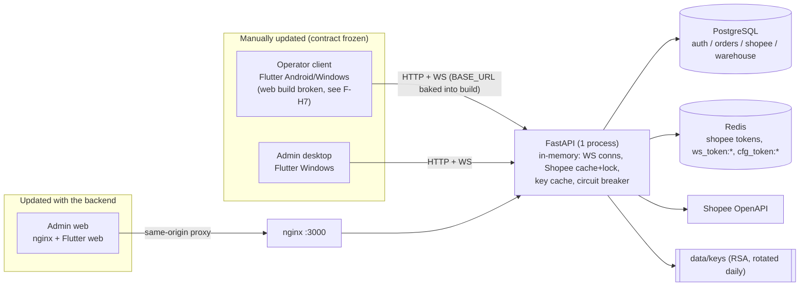

# Branch-split readiness review

> **Archived 2026-11-21 (at commit `2081206`).** Historical record, not maintained, and
> not authoritative for current behaviour. Snapshot of commit `187122c` (2026-11-20). The frozen client contract v1 now lives in [SYSTEM_REFERENCE.md §10](../SYSTEM_REFERENCE.md#10-operator-client-contract-v1) and in the contract tests; findings were resolved through [IMPLEMENTATION_PLAN.md](../IMPLEMENTATION_PLAN.md).

Reviewed at commit `187122c` (2026-11-20), `master`, with uncommitted tooling changes only
(`.gitignore`, client `analysis_options.yaml`, Gradle files, `pubspec.lock`).
**No code was changed by this review.** It covers four things:

1. A map of every HTTP/WebSocket path and the flows that use them.
2. The parts of the API the operator client depends on and which therefore must not change.
3. Inconsistencies, defects, and inefficiencies, ranked, with a note on whether each fix
   stays inside the frozen client contract.
4. A proposed plan for the production/dev branch split, with recommendations wherever the
   path is ambiguous.

Severity: **C** critical (wrong results or a security exposure in production), **H** high,
**M** medium, **L** low. "Client-safe" means the fix needs no change to the operator client.

---

## 1. System map



The **admin desktop (Windows)** build has the same manual-update problem as the operator
client. See ambiguity A-6.

### 1.1 HTTP inventory and usage matrix

`C` = operator client, `A` = admin app. "WS fan-out" lists the pushes the call triggers.

| Method | Path | Scope | C | A | WS fan-out / side effects | Notes |
|---|---|---|:-:|:-:|---|---|
| POST | `/auth/register` | public | ✔ | | `users_update`→admins | Open self-registration (F-C3) |
| POST | `/auth/login` | public | ✔ | | | Accepts any scope, admins included |
| POST | `/auth/admin` | public | | ✔ | | |
| POST | `/auth/refresh` | public | ✔ | ✔ | | Rotation is not atomic (F-H5) |
| POST | `/auth/logout` | public | ✔ | ✔ | | Returns 400 for a malformed token |
| POST | `/auth/ws-token` | user | ✔ | ✔ | Redis `ws_token:*` | |
| GET | `/.well-known/jwks.json` | public | ✔ | ✔ | | Clients cache it for 15 min |
| GET | `/admin/users` | admin | | | | Unused: admin reads users over WS |
| DELETE | `/admin/users?username=` | admin | | ✔ | `users_update`→admins | User's open WS sessions survive (F-M9) |
| GET | `/admin/history/outbound` | admin | | ✔ | | Unbounded, no pagination |
| GET | `/admin/history/shopee/orders` | admin | | ✔ | | Unbounded; rebuilds BOM per order |
| GET | `/admin/export/scans` | admin | | ✔ | | Exports **all** scans, despite the "open scans" summary |
| GET | `/admin/export/stocks` | admin | | ✔ | | |
| DELETE | `/admin/clear/outbound-items` | admin | | ✔ | `outbound_update`→admins | Irreversible |
| GET | `/admin/bom/headers` | admin | | ✔ | | N+1 queries; no response model |
| GET | `/admin/bom/tree?sku=\|shopee_id=&qty=` | admin | | ✔ | | `qty` not validated (0/negative accepted) |
| POST | `/admin/shopee-config/unlock` | admin | | ✔ | Redis `cfg_token:*` | Argon2 runs on the event loop |
| GET/POST | `/admin/shopee-config?token=` | admin+cfg | | ✔ | resets cache/circuit | Token sent in the query string |
| POST | `/admin/shopee-config/lock?token=` | admin | | ✔ | | |
| GET | `/outbound` | user | | | | Unused: both apps use WS `get_items` |
| POST | `/outbound` | user | ✔ | | `outbound_update`→admins+self | Duplicate check is per user only |
| POST | `/outbound/close` | admin | | ✔ | `outbound_update`, `shopee_orders_update`→admins | Body is a bare JSON array |
| GET | `/items/find?query=` | user | ✔ | ✔ | | LIKE wildcards not escaped (F-H3) |
| GET | `/stocks` | user | | | | Unused: both apps use WS `get_stocks` |
| POST | `/stocks/update` | user | ✔ | | `stocks_update`→**everyone** | |
| GET | `/shopee/orders?refresh=` | user | ✔ | ✔ | `shopee_orders_update`→admins+caller | Upstream sync on GET; **both apps ignore the body** |
| POST | `/shopee/orders/acquire?order_sn=` | user | ✔ | | `shopee_orders_update`→caller+admins | Not atomic (F-H4) |
| POST | `/shopee/reset-cache-state` | admin | | ✔ | | |
| GET | `/pick-items` | user | | | | Unused; N+1 barcode resolution |
| POST | `/pick-items` | user | ✔ | | picks→self+admins, `stocks_update`→everyone | Deducts stock; `order_sn` not ownership-checked |
| POST | `/pick-items/{id}/assign` | user | ✔ | | picks→self+admins | Two transactions |
| POST | `/pick-items/unassign` | user | ✔ | | picks→self+admins | Two transactions |
| DELETE | `/pick-items/{id}` | user | ✔ | | picks→self+admins | Stock is **not** returned (A-4) |

Five operations are dead weight, called by neither app: `GET /admin/users`, `GET /outbound`,
`GET /stocks`, `GET /pick-items`, and the response body of `GET /shopee/orders`. They are
harmless, but each one is still contract surface that has to be kept working and secured.

### 1.2 WebSocket protocol (`/ws?token=<ticket>`)

| Client → server command | Response event(s) | Data for client scope | Data for admin scope |
|---|---|---|---|
| `get_items` | `outbound_update` | own open scans | all open scans |
| `get_shopee_orders` | `shopee_orders_update` + `pick_item_entries_update` | **own claimed** orders, own picks | all active orders, all picks |
| `get_stocks` | `stocks_update` | all stock | all stock |
| `get_users` | `users_update` / `error` | `error: "Forbidden"` (a **string**) | client-scope users |
| *anything else* | `error` | `"Unknown command: …"` (a **string**) | same |

The command name `get_items` actually returns outbound scans. The name is frozen because the
client sends it.

### 1.3 Interaction flows

#### Session lifecycle (both apps)

1. Login (`/auth/login` or `/auth/admin`) stores the access token, refresh token, and username in secure storage.
2. On startup, `isTokenValid` checks the access-token signature against the cached JWKS. If that fails it fetches the JWKS once more. If the token is still invalid, it calls `/auth/refresh`.
3. Each request sends the bearer token. On a 401 the app calls `performRefresh()` (de-duplicated by a completer) and retries once. If refresh fails, it logs out.
4. WebSocket: `POST /auth/ws-token`, then `WS /ws?token=`. On error or close, the client retries 5 times at 2 s intervals and then **gives up** until the user taps retry. If the error text contains `"403"`, it refreshes the token and reconnects.

#### Order claim, pick, scan (operator client)

```mermaid
sequenceDiagram
  participant Op as Operator client
  participant API
  participant DB as Postgres
  participant SH as Shopee
  Op->>API: POST /shopee/orders/acquire?order_sn=X
  API->>DB: SELECT order; UPDATE owner_user (no lock)
  alt 404 (not synced yet)
    Op->>API: GET /shopee/orders?refresh=true (body ignored)
    API->>SH: 5 statuses × pages, details/50, tracking/50
    API->>DB: upsert orders
    API-->>Op: WS shopee_orders_update (own orders only)
    API-->>Op: HTTP 200 [ALL active orders, BOM-expanded] (discarded)
    Op->>API: POST acquire again
  end
  API-->>Op: WS shopee_orders_update (own)
  loop per scanned item
    Op->>API: POST /pick-items {sku|barcode, qty, order_sn}
    API->>DB: resolve barcode, deduct stock (clamp ≥0), upsert pick
    API-->>Op: WS pick_item_entries_update
    API-->>All: WS stocks_update (full inventory to every socket)
  end
  Op->>API: POST /outbound {content: label}
  API-->>Op: WS outbound_update
```

#### Period close (admin)

`POST /outbound/close [labels…]` closes matching open scans, marks orders `done` when the
order number or tracking number matches, invalidates the Shopee cache, and pushes updates to
admins. Clients only learn that their scans were closed the next time they send `get_items`.

#### Stock adjust/transfer (client)

`POST /stocks/update` resolves the barcode, applies set/add/move (single-location bypass
optional), writes a free-text log row, and sends the **full** stock snapshot to every socket.

#### Shopee sync

Sync runs on the request path, under a process-local `asyncio.Lock` with a 2-minute TTL. Any
user can force it with `refresh=true`. Request flow: 5 status lists, then detail chunks, then
tracking chunks, then one DB transaction. Failures are swallowed only when `MOCK_ORDER_BYPASS`
is set.

#### Key rotation

Rotation runs daily: publish the new public key, wait 330 s, switch the signer, wait 930 s,
then **delete every old key**. See F-C2.

---

## 2. Frozen operator-client contract (v1)

Everything the shipped client relies on is listed here, from
`frontend/client/lib/app_state.dart` and `frontend/client/lib/models.dart`. Treat this list as
**API v1**. Breaking any item requires a major version bump and a manual client rollout.

**Base URL.** Baked into the build from the bundled `.env` asset (`BASE_URL`, `WS_URL`). The
client cannot discover a server, so a prod client and a dev client are separate builds.

**Requests sent.** All bodies are JSON with `Content-Type: application/json`.

| Call | Shape relied on |
|---|---|
| `POST /auth/login`, `/auth/register` | body `{username, password}` → 200 `{access_token, refresh_token}`; 400/401/409 → show `detail` |
| `POST /auth/refresh` | `{refresh_token}` → 200 same token pair; anything else → logout |
| `POST /auth/logout` | `{refresh_token}`; result ignored |
| `POST /auth/ws-token` | 200 `{token}`; ≥500 → retry; other non-200 → logout |
| `GET /.well-known/jwks.json` | RS256 JWKS; access tokens must stay JWS-verifiable with `exp` as an int |
| `POST /outbound` | `{content, tags: null}` → 200; 409 → alert with `detail` |
| `POST /pick-items` | `{sku, qty, order_sn?}` → 200 |
| `POST /pick-items/{id}/assign` | `{order_sn, qty?}` → 200 |
| `POST /pick-items/unassign` | `{order_sn, sku, qty}` → 200 |
| `DELETE /pick-items/{id}` | → 200 |
| `POST /shopee/orders/acquire?order_sn=` | 200 / **404 drives a refresh-and-retry flow** / other → error |
| `GET /shopee/orders?refresh=true` | only `statusCode == 200` matters |
| `GET /items/find?query=` | **query is not URL-encoded**; 200 → `[{sku, item_name, location}]` |
| `POST /stocks/update` | `{sku, stock, mode, location?, move_to?}` → 200 |
| `WS /ws?token=` | rejection must surface as an error containing `403` (HTTP 403 handshake) |
| WS commands | `get_items`, `get_shopee_orders`, `get_stocks` |

**Success means exactly `200`.** Every call checks `statusCode == 200`. Switching any of these
to 201 or 204 is a breaking change. 401 triggers a refresh, 409 shows an alert, and ≥500 shows
"Server error".

**WebSocket frame rule (critical).** The client runs
`List<Map<String, dynamic>>.from(data['data'])` *before* it checks `type`
(`app_state.dart:244`). Consequences:

- **Every frame sent to a client socket must have `data` as a JSON array of objects.** A string
  (today's `error` frames), `null`, or an object throws inside the listener.
- New event types are safe only if they follow that shape. The client then ignores them.
- Today the client never triggers `error` frames, because it only sends known commands.
  Server-initiated string payloads must stay off client sockets.

**Response fields parsed as required.** Missing, null, or wrongly typed values crash parsing:

- `OutboundItem`: `id:int`, `created_at:ISO-8601`
- `ShopeeOrder`: `order_sn:str`, `ship_by:ISO-8601`; nested `info[].id:int`, `recipient_address.id:int`, `item_list[].quantity:int`
- `PickItemEntry`: `id:int`, `timestamp:ISO-8601`
- `Stock`: `id:int` (synthetic `id=0` rows are fine)

Optional fields fall back to defaults: `split_up` (always sent as null today, see F-M5),
`done`, `tags`, `owner_user`, and names.

**Safe evolution (client-safe):**

- Add response fields.
- Add endpoints.
- Add a timezone suffix to datetimes (`Z` / `+00:00`). `DateTime.parse` accepts both.
- Add WS event types whose `data` is a list of objects.
- Make the server stricter in ways that still return 200, 401, 409, or a non-200 error the client already handles.

**Breaking (major):**

- Renaming or removing paths, fields, or commands.
- Changing a success code.
- Turning a list into an object.
- Sending non-list WS `data` to client sockets.
- Changing the claim 404 semantics.
- Requiring new request fields or headers.

---

## 3. Findings

### 3.1 Critical

| ID | Finding | Location | Impact | Client-safe fix |
|---|---|---|---|---|
| **F-C1** | The active-order filter freezes "now" at import time: `ship_by >= datetime.now(UTC)` is evaluated once, when the module-level `lection_query` is built. | `backend/src/services/queries/orders.py:19-28` | After a server start, orders whose ship-by passes **stay "active"** until the next restart. Operators see, and can claim, expired orders. | ✔ Build the query in a function, or use `func.now()` |
| **F-C2** | Key rotation deletes every old key 930 s after switching signers, but refresh tokens live 24 h. A restart during rotation deletes old keys immediately (cancel handler). | `backend/src/services/managers/key_manager.py:147,200,208` | Any device idle across the daily rotation fails refresh (unknown `kid`) and is **logged out, roughly daily**. A deploy during rotation logs out everyone. For manually updated scanners this is the most visible production defect. | ✔ Keep public keys for `max(ACCESS_TTL, REFRESH_TTL) + leeway`. Prune by key age, not "all except newest". Don't prune in the cancel path. |
| **F-C3** | `POST /auth/register` is public and the client exposes it. | `backend/src/routers/auth.py:24`, `frontend/client/lib/app_state.dart:592` | Anyone who can reach the API can create an operator account, then read every active order (recipient name and city), change stock, and create picks. | ✔ Add a config flag that disables registration in prod and returns 403 with a `detail` (A-3). Keep the path. |
| **F-C4** | Redis and Postgres ports are published on all interfaces. Redis has no auth. | `backend/compose.yaml:66,81` | Anyone with Redis access can read the Shopee tokens or **forge `ws_token:<x> = admin`** and stream every user, order, and scan over WS. | ✔ Prod compose override: no published ports, `requirepass`/ACL, internal network |

### 3.2 High

| ID | Finding | Location | Impact | Client-safe |
|---|---|---|---|---|
| F-H1 | Async handlers call **synchronous** SQLAlchemy and Argon2. `get_current_user` (async) runs a DB query on **every** authenticated request. `register_client` and `unlock_shopee_config` hash on the loop. WS fan-out builds payloads synchronously. | `auth_service.py:90`, `admin_shopee.py:39`, `connection_manager.py:45`, `websocket.py:33` | One slow query or a full Shopee sync stalls **all** HTTP and WS traffic, including heartbeats. This is the main latency risk on a single worker. | ✔ Make the dependencies plain `def` (threadpool) or wrap them in `run_in_threadpool`. Longer term, an async engine. |
| F-H2 | `build_shopee_order_response` runs a recursive BOM resolution per order item, with about 3 queries per BOM node plus one per leaf, and opens extra sessions. One sync builds the full set **three times**: admin broadcast, caller push, and the HTTP body nobody reads. | `shopee_service.py:421,508-593`, `connection_manager.py:70` | O(orders × BOM nodes) queries per sync and per order-changing action. It scales badly with order volume. | ✔ Batch-load BOMs and items once, cache the BOM expansion per SKU, build once per audience |
| F-H3 | Barcode/SKU lookup passes scanned input straight into `ILIKE`, so `%` and `_` act as wildcards. | `warehouse.py:48,54,60,69` | A scan of `%` resolves to an arbitrary item, and `POST /pick-items` / `/stocks/update` **mutate the wrong SKU's stock**. `_` in SKUs (`A01_001`) matches any character. | ✔ Escape LIKE metacharacters, or use `lower(col) = lower(:v)` for exact matches |
| F-H4 | Order claim is read-modify-write without a lock or conditional update. | `orders.py:81-96` | Two operators claiming at once can both get 200; the last write wins and one operator works an order they don't own. It also lets a user claim `done` or expired orders. | ✔ `UPDATE … WHERE order_sn=:sn AND (owner_user IS NULL OR owner_user=:u) AND done=false RETURNING`. 404 vs 409 semantics stay the same. |
| F-H5 | Refresh-token rotation is SELECT then DELETE then INSERT across separate sessions. | `auth_service.py:254-290`, `users.py` | Two concurrent refreshes with one token both succeed: the token is spent twice and there is no reuse detection. | ✔ `DELETE … WHERE jti=:j RETURNING` as the single gate |
| F-H6 | Stock mutations run without row locks, and there is no unique constraint on `(sku, location)`. Pick deduction and adjustments race. | `stocks.py:59,346`, `models.py:287` | Lost updates and duplicate location rows under concurrent scanning. | ✔ `SELECT … FOR UPDATE`, plus a migration adding a unique index (treat NULL location carefully) |
| F-H7 | The client still uses `IOWebSocketChannel.connect`, even though Known Limitation #7 says not to. | `frontend/client/lib/app_state.dart:232` | The README advertises a client **web** build, but it cannot open a WebSocket there. | ✘ Client change: either fix it in the next client major, or drop "web" from the supported client targets now |
| F-H8 | The client WebSocket gives up after 5 retries at 2 s intervals (about 10 s). | `frontend/client/lib/app_state.dart:301` | Any backend restart longer than about 10 s (deploy, migration) strands every scanner until an operator taps retry. | ✘ for the client. Server side: keep deploy downtime under 10 s (pre-run migrations, fast restart), document it in the runbook (§4.5) |
| F-H9 | Shopee failure paths log `str(e)` with `exc_info`. aiohttp `ContentTypeError` and `ClientResponseError` messages include the **full request URL**, which carries `access_token` and `sign` as query parameters. | `shopee_service.py:308-313` | Shopee access tokens can leak into `logs/backend.log` whenever the gateway returns HTML (5xx or maintenance). | ✔ Redact query strings before logging; log path and request ID only |

### 3.3 Medium

| ID | Finding | Location | Notes / client-safe |
|---|---|---|---|
| F-M1 | Period close computes `unknown = len(inputs) - rows_closed`. Scans are deduplicated per user only, so two operators scanning the same label produce 2 rows for 1 input and **`unknown` goes negative or under-counts**. | `outbound.py:48,114` | ✔ Count distinct matched `content` |
| F-M2 | Sync only looks back `SHOPEE_SYNC_WINDOW_DAYS` (2) by `create_time`. Orders older than that are never refreshed, so a 3-day-old order cancelled upstream stays `READY_TO_SHIP`. Combined with F-C1, it never leaves the active list. Existing orders' `ship_by`, items, and recipient are also never updated. | `shopee_service.py:516-518`, `orders.py:139-178` | ✔ Also re-fetch details for locally active orders, or query by `update_time` |
| F-M3 | Partial sync failures are silent. A failed detail chunk returns `([], {}, set())`, and the sync is still `mark_synced()`. | `shopee_service.py:375-380,569` | ✔ Track failed chunks; skip `mark_synced` or shorten the TTL |
| F-M4 | Error statuses don't match the docs. Shopee list failure raises **400** and the circuit breaker raises **500** (docs say 502). Register duplicate returns 400 (docs say 409). WS rejection uses `HTTPException` before `accept()`. | `shopee_service.py:135,346`, `auth_service.py:195`, `websocket.py:21` | ✔ mostly, because the client only distinguishes 200/401/409/≥500. Keep register duplicate as 400 or 409 (the client handles both). Keep WS rejection an HTTP 403 handshake (client contract). Switch to `WebSocketException`/denial response, but verify the client still sees "403". |
| F-M5 | `ShopeeOrderResponse` declares `split_up`, `shipping_carrier`, and `done_at`, but `build_shopee_order_response` never fills them, so they are always null. | `shopee_service.py:489-498` | ✔ Additive fix |
| F-M6 | Datetimes are stored naive (`DateTime` without tz) and serialized without an offset. Dart parses them as **local** time; `toLocal()` is then a no-op, so scan, ship-by, and history times show UTC wall-clock as local (likely 7 h off). | `models.py:94` etc., `scanner_view.dart:199` | ✔ Emit `Z` (Pydantic serializer or `DateTime(timezone=True)` migration). The client parser accepts it. |
| F-M7 | HTTP `GET /shopee/orders` returns **all** active orders to operators, while WS gives operators **only their own**. Two read paths show different data, and the HTTP one exposes recipient PII to every operator. | `shopee_service.py:591`, `connection_manager.py:70` | ✔ Scope the HTTP body (the client ignores it), or make it return a small summary |
| F-M8 | `POST /pick-items` accepts any `order_sn` without an ownership or existence check. An unknown SN raises an FK `IntegrityError`, which surfaces as 500. Assign doesn't check that the entry is unassigned or that the order is still active. | `pick_items.py:74-117` | ✔ Validate and return 404/409 (the client treats non-200 as failure) |
| F-M9 | Deleting a user leaves their open WS sessions streaming. Scope is captured once at connect. HTTP is cut off on the next request because `get_current_user` hits the DB, but WS is not. | `admin.py`, `connection_manager.py` | ✔ Close that user's sockets on delete or scope change |
| F-M10 | `ConnectionManager.disconnect` calls `list.remove` without a guard. A failed send already disconnects the socket, and the later `WebSocketDisconnect` handler removes it again, raising `ValueError` when the user has other sessions. | `connection_manager.py:32` | ✔ |
| F-M11 | WS ticket consumption is GET followed by DEL, so two connects can share one ticket. | `ticket_manager.py:39` | ✔ `GETDEL` |
| F-M12 | Pick, assign, and unassign each run as 2 transactions (`delete/decrement` → `merge_or_create_pie`). A crash in between loses quantity. | `pick_items.py:157,175` | ✔ One session per service call (the unit of work already listed in CODE_REVIEW) |
| F-M13 | Fan-out recomputes per recipient. `broadcast` calls `_get_data` once per client username and once for admins, and each call also re-queries the user. `stocks_update` is identical for every recipient but is rebuilt N times and sent as a **full inventory snapshot on every pick or adjust**. | `connection_manager.py:45,134` | ✔ Compute scope-independent payloads once; pass the scope in instead of looking it up |
| F-M14 | CORS: with explicit origins, the default regex **always** also allows `localhost:*`. The compose default is `CORS_ORIGINS=*`. | `main.py:176`, `compose.yaml:26` | ✔ Prod profile: no localhost regex, no `*` |
| F-M15 | Production defaults that only warn: `admin/admin` seed password; `/docs`, `/redoc`, `/openapi.json` public; the SQLite fallback when `DATABASE_URL` is missing; `MOCK_ORDER_BYPASS` honoured in any environment. | `main.py:71-79`, `engine.py:13-19` | ✔ Fail fast when `APP_ENV=production` (§4.2) |
| F-M16 | Compose declares the "super sensitive" secrets (`DATABASE_URL`, `PARTNER_KEY`, `ADMIN_PASSWORD`) as **environment-backed**, contradicting OPERATIONS.md. Seed `access_token`/`refresh_token` secrets are declared but never attached. | `compose.yaml:109-130` | ✔ Prod override with `file:` secrets |
| F-M17 | No login rate limiting. Argon2 per attempt also makes `/auth/login` a cheap CPU-exhaustion target. A missing user skips hashing, which leaks username existence by timing. | `auth_service.py:205` | ✔ Ingress or app rate limit; dummy hash on a missing user |
| F-M18 | Short-lived secrets travel in query strings (`cfg_token`, `ws` ticket) and end up in nginx/uvicorn access logs. | `admin_shopee.py:67,88,116`, `websocket.py` | `ws` ticket: frozen (client); it is one-use with a 30 s life, so acceptable. `cfg_token`: admin-only, so ✔ move it to a header. |

### 3.4 Low / consistency / docs drift

- **Three unrelated version numbers.** `pyproject` is `0.1.0-alpha.2`, `API_VERSION` is `0.3.0-alpha`, `JWT_VERSION` is `v0.3a`, and both Flutter apps are `1.0.0+1`. `JWT_VERSION` is baked into `aud`/`iss`, so bumping it **logs everyone out** (A-7).
- **nginx proxy regex** lists `pick_items`, but the route is `/pick-items` (`frontend/admin/nginx.conf.template:47`). It is harmless only because admin never calls it.
- **Package chunk size.** `SHOPEE_PACKAGE_CHUNK_SIZE` defaults to 50 in code and OPERATIONS, but ARCHITECTURE and CODE_REVIEW say 10.
- **Undocumented legacy alias.** `STOCK_SINGLE_LOCATION_BYPASS` (`stocks.py:18`) is not documented anywhere.
- **Missing files referenced.** KNOWN_LIMITATIONS #6 cites `AGENTS.md` and `GEMINI.md`, which are not in the repo.
- **Known Limitation #7** names only the admin app; the client still has the bug (F-H7).
- **Export summary is wrong.** `/admin/export/scans` claims "open scans" but exports all of them.
- **No length limits** on `OutboundCreate.content`/`tags`, stock `location`, pick `sku`, or `/outbound/close` list size.
- **`/admin/bom/tree` `qty`** accepts 0 or negative values.
- **Dead code:**
  - `stock_service.get_or_merge_stock` (tests only)
  - the `resolve_standard_bom(_internal)` chain, which also lacks a cycle guard and would recurse forever on a cyclic BOM
  - `barcode_service`
  - `pick_item_service.merge_or_create_pie`
  - `get_all_warehouse_items`
  - `get_all_stocks_data` (an alias)
  - `ShopeeOrderCreate`
  - the `PickItemEntryLog` table, which is never written
- **Production dependency bloat.** `fastapi-cloud-cli` and `fastapi-cli` are in the production `requirements.txt`.
- **Migrations on every start.** `alembic upgrade head` runs on each container start (`Dockerfile:55`). That is fine for one replica and racy for more.
- **Untracked AI tooling file.** `CLAUDE.md` is now git-ignored by the pending `.gitignore` change, so it is not a durable place for project policy. Policy lives in `KNOWN_LIMITATIONS.md` (#8).
- **Client-side issues (fix only in the next client major):**
  - `items/find` and `orders/acquire` build query strings without encoding, so `&`, `#`, and `+` in barcodes are mangled.
  - The over-quantity warning compares the raw scan to `component_sku`, so it never fires for supplier barcodes.
  - `handleLogout` doesn't clear `_orders` or `_pickItemEntries`.
  - 403 is detected by matching the string `"403"`.
  - The app ignores HTTP response bodies and depends on WS pushes.

---

## 4. Proposed plan for the production/dev branch split

### 4.1 Branch model

| Branch | Role | Rules |
|---|---|---|
| `master` | **production** (keep the name, A-1) | Protected; merge only via release PR from `dev`; every merge is tagged `vX.Y.Z` and deployed |
| `dev` | integration / staging (made the default branch) | Feature branches merge here; deployed to the dev stack automatically or on demand |
| `hotfix/*` | from `master` | Merged to `master` **and** back to `dev` |
| `client/vN` *(only if needed)* | tracks a shipped client major | Created only when a client major ships, to rebuild or patch that client (A-5) |

**One codebase for both environments.** Environment differences come from configuration
(§4.2), never from code that exists on one branch and not the other. Code that diverges by
branch makes every release a merge conflict and lets dev-only bypasses leak into production.

### 4.2 Environment profile (`APP_ENV=development|staging|production`)

At startup, `APP_ENV=production` must **refuse to start** if any of these hold:

- the default or empty admin password, or `ADMIN_USERNAME=admin` with the seeded default
- `CORS_ORIGINS=*`, or the implicit localhost regex
- `MOCK_ORDER_BYPASS` enabled
- `DATABASE_URL` missing (no SQLite fallback)
- the `REDIS_URL` has no auth
- `/docs`, `/redoc`, `/openapi.json` enabled, unless `EXPOSE_API_DOCS=1`
- `ALLOW_REGISTRATION` unset (default off in prod)

Deployment files:

- `compose.yaml` stays the dev default.
- Add a **`compose.prod.yaml` override** with:
  - no published Postgres or Redis ports
  - Redis `requirepass`
  - `file:` secrets for `database_url`, `partner_key`, `admin_password`
  - `restart: unless-stopped`
  - a Redis healthcheck
  - a log volume
- Add `.env.production.example` next to `.env.example`. Inspect only the example files (KNOWN_LIMITATIONS #6).

Separate per environment:

- Compose project name, volumes, `KEYS_VOLUME`, Redis DB/instance, Shopee credentials (sandbox URL for dev), and the admin password.
- Make **`JWT_ISSUER`/`JWT_AUDIENCE` environment-specific**, for example `api.bakingholic:prod`, so a dev token is never accepted by prod even if keys are copied (A-7).

### 4.3 Contract protection (do before splitting)

1. **Client contract test suite** (`tests/test_client_contract_v1.py`). For each operation in §2:
   - Assert the path, method, and request schema exist and that the success code is 200.
   - Assert that the required response fields exist and are non-nullable.
   - Snapshot the relevant OpenAPI fragments into `tests/contracts/client_v1.json`. Any diff fails CI unless it is purely additive.
2. **WS frame test.** Every frame sent to a client-scope socket has `data` as a list of dicts. This would catch today's `error` string frames being sent to clients.
3. **Migration gate.** On each release PR, upgrade from an empty DB **and** from the last production tag's schema. Use the expand/contract pattern: never drop or rename a column the frozen contract reads in the same release that stops writing it.
4. **Client compatibility policy** recorded in `KNOWN_LIMITATIONS.md` #8 (added with this review) and linked from `docs/API.md`.

### 4.4 Suggested sequencing

| Step | Where | Content |
|---|---|---|
| 0 | `master` (now) | Commit this report and the contract tests (§4.3); pin the client v1 contract snapshot |
| 1 | `master` → becomes first prod release | Client-safe correctness fixes: F-C1, F-C2, F-H3, F-H4, F-H5, F-M1, F-M10, F-M11 (small, high value, no contract change) |
| 2 | `master` | `APP_ENV` profile and fail-fast checks, `compose.prod.yaml`, Redis auth, registration flag (F-C3, F-C4, F-M14–M16) |
| 3 | create `dev` from `master`; tag `v0.4.0` (A-7) | Branch protection, CI split (dev: full suite; release PR: suite + contract + migration gate + manual smoke from TESTING.md) |
| 4 | `dev` | Performance work: F-H1, F-H2, F-M13, plus unit of work (F-M12, F-H6), datetime offsets (F-M6), sync completeness (F-M2, F-M3) |
| 5 | `dev` | Admin-only API cleanup (allowed to break, §4.6), pagination for history, dead-code removal |

### 4.5 Deploy runbook constraints imposed by the frozen client

- Keep backend downtime **under 10 s** (F-H8). Build the image first, run `alembic upgrade` as a separate step before swapping, then restart.
- **Never deploy during key rotation** until F-C2 is fixed, because it causes a mass logout. Once fixed, restarts are safe.
- Do **not** change `JWT_ISSUER`, `JWT_AUDIENCE`, `JWT_VERSION`, or replace `data/keys` except in a planned forced-relogin window.
- Keep the WS handshake rejection as HTTP 403 (the client keys on the string `"403"`).

### 4.6 What may change freely

- Admin-web-only endpoints: `/admin/*`, `/outbound/close`, `/shopee/reset-cache-state`, the `get_users` WS command, `/auth/admin`. The web build ships with the backend. Coordinate this with the admin desktop question (A-6).
- Response *bodies* that the client ignores: the body of `GET /shopee/orders` and every HTTP 200 body except `ws-token`, `login`, `register`, `refresh`, and `items/find`.
- Internals: everything behind the routers.

---

## 5. Ambiguous decisions and recommendations

| # | Question | Options | Recommendation |
|---|---|---|---|
| A-1 | Is `master` production, or is a new `main`/`production` branch created? | (a) `master` = prod, new `dev`; (b) rename to `main`; (c) new `production` branch, `master` = dev | **(a).** Least churn. The remote and history already treat `master` as the release line; make `dev` the default branch for day-to-day work. |
| A-2 | Are bypasses compiled out on prod, or are they flags? | per-branch code vs `APP_ENV` guard | **Flags plus a prod guard** (§4.2). Never keep branch-specific code. |
| A-3 | Registration in production: disable, invite-only, or admin-created? | flag → 403 / 400; admin `POST /admin/users` | Short term, `ALLOW_REGISTRATION=0` in prod returns **403** with `detail`. The client shows "Registration failed (Status 403)": clear enough, and no client change. Medium term, add admin-side user creation (admin API, free to add). Return 400 instead only if you want the client to display the server's `detail` text verbatim. |
| A-4 | Should deleting or unassigning a pick entry return stock? Pick deducts at creation, delete doesn't restore. | restore on delete / never restore / restore only for unassigned entries | A business decision, so confirm with operations. Recommendation: **restore on delete**. A deleted entry means "mis-scan". Log it as a structured stock movement. It is client-safe. |
| A-5 | How will a breaking client change ship? | path versioning `/v2/...`, header versioning, new host | **Path versioning only for the changed operations.** Unprefixed paths are v1 and stay until v1 devices are retired. Add `GET /meta` now (additive: API version, min/max client contract, feature flags) so v2 clients can negotiate. v1 never calls it. Header versioning is invisible to v1 and gives no benefit here. |
| A-6 | Is the **admin Windows desktop** build a supported production target? | supported (frozen like the client) / web-only | **Web-only for production.** Otherwise the admin API inherits the same freeze. If desktop admin must stay, give it its own contract snapshot like §2. |
| A-7 | When to make JWT iss/aud environment-specific and unify versioning (forces one relogin)? | at the split / later | **At the split** (step 3), announced, after F-C2 is fixed. Devices are currently logged out roughly daily anyway (F-C2), so the one-time cost is low. Use one SemVer source (`pyproject`), derive `API_VERSION` from it, and keep a separate `CLIENT_CONTRACT=1`. Decouple `JWT_VERSION` from releases. |
| A-8 | Is `SINGLE_LOCATION_STOCK_BYPASS` a dev bypass or a production business mode? | dev-only (blocked in prod) / prod setting | It reads like an operational mode, not a test hack. **Allow it in prod** and rename it later to `STOCK_LOCATION_MODE=single\|multi`, keeping the old name as an alias. Do not include it in the prod fail-fast list. |
| A-9 | Should operators see all active orders (for claiming), or only their own? HTTP and WS disagree today (F-M7). | all / own / all-but-redacted | The client only uses its own orders (WS) and claims by scanning an SN. **Scope HTTP to own**, or return no body. That removes recipient PII from other operators. |
| A-10 | Dev data: a copy of prod, or synthetic? | prod snapshot / seed scripts | **Synthetic seeds plus the Shopee sandbox.** Prod snapshots carry recipient PII and live order SNs, and TESTING.md already forbids real customer data in fixtures. |

---

## 6. Longer-term integration notes (secondary)

- **Sync milestone (KNOWN_LIMITATIONS #3).** Ship `GET /meta` (versions, feature flags, active bypass modes) and a matching WS event in **list-of-objects shape**, so v1 clients ignore it safely. Do this before the next client major, so the v2 client can be built against it and use it for OTA/update prompts.
- **Move Shopee sync off the request path.** Run it as a background task or worker on a schedule, with distributed locking in Redis. `GET /shopee/orders?refresh=true` then just enqueues a sync and returns 200. That keeps the v1 contract and removes the event-loop stalls. Consider Shopee push notifications (order status webhooks) to replace polling the 5 status lists.
- **Unit of work plus outbox.** One session per service operation; publish WS events after commit. This is the prerequisite for multiple workers and for Redis pub/sub fan-out (already in CODE_REVIEW).
- **Delta events (v2 client).** Keep full snapshots for v1 sockets. Add per-entity delta events for v2. Pick the frame format by the client's declared contract (for example `?contract=2` on `/ws`), and default to v1.
- **Structured stock ledger.** Replace free-text `StocksLog.message` with `(sku, from_loc, to_loc, delta, before, after, reason, actor, ref)`. This enables reconciliation for KNOWN_LIMITATIONS #5 and the Integration milestone.
- **Typed API client in Flutter (v2).** Generate it from the OpenAPI spec, split `AppState` per feature, URL-encode every query, and parse WS frames defensively (check `type` before `data`).
